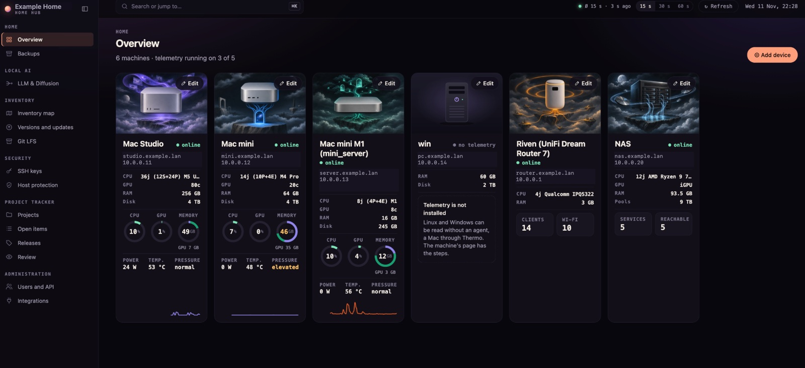
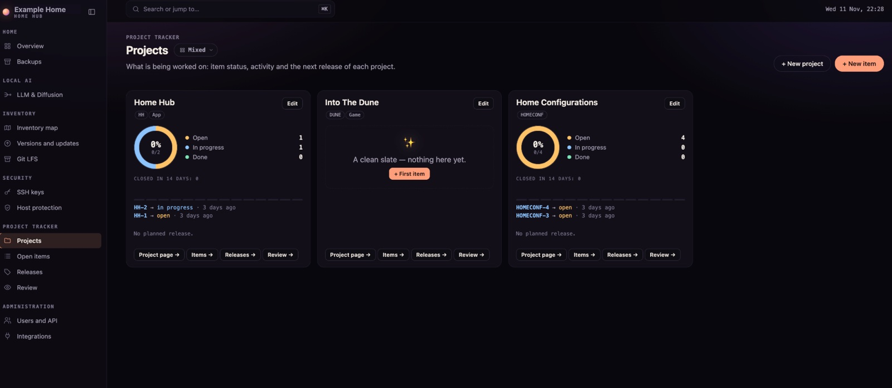
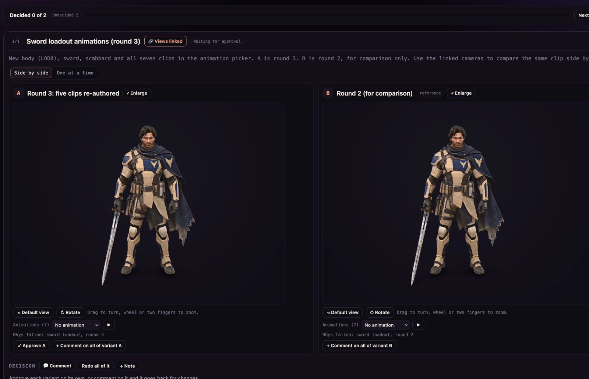

# Home Hub
<!-- home-hub:public-readme -->

Home Hub is a self-hosted hub for the machines of a home: see how each machine is doing, what it runs,
what depends on it, and what needs attention. It brings live telemetry, a services catalog, inventory,
software versions, security checks and local AI runtimes together with a project tracker and review space.

It is built so your AI agent can do half the work. Agents read and update the same inventory through the
HTTP API and MCP endpoint, add machines and their runtime stacks, maintain tickets, and publish work for
you to review. **Integrations → Machines** shows what is connected on each machine and hands you a prompt
for your own agent to set up the missing pieces. You decide what access it gets through scoped service accounts.

One Node process, zero third-party npm dependencies, a vanilla-JavaScript UI, and files you can back up.
A fresh public edition starts empty, with no household configuration or plugins.

## Screenshots

Examples from a configured hub, with identifying site and network labels replaced. Machine artwork and
project content are examples, not data bundled with a fresh installation.

**Overview — machine status, live telemetry and services at a glance.**



**Projects — work, activity and the next release in one place.**



**Review — compare 3D variants, play animations and leave decisions for your agent.**



## Contents

- [Quick start](#quick-start)
- [Docker](#docker)
- [Connect your agent](#connect-your-agent)
- [What works out of the box](#what-works-out-of-the-box)
- [Make it yours](#make-it-yours)
- [What is in it](#what-is-in-it): [overview and machines](#overview-and-machines),
  [inventory](#inventory-map-table-and-services-catalog),
  [tracker, review and search](#project-tracker-review-and-search),
  [users and access](#users-roles-and-service-accounts)
- [Live telemetry (optional)](#live-telemetry-optional)
- [How LLM stats are read](#how-llm-stats-are-read)
- [Collectors (optional)](#collectors-optional)
- [Plugins](#plugins)
- [Security model](#security-model)
- [Running it for real](#running-it-for-real)
- [Documentation](#documentation)
- [Development](#development)

## Quick start

You need Node 22.13 or newer (use a current patched Node 22+ release). There is no `npm install` step.

```sh
# Copy the clone URL from this repository’s Code button.
git clone <repository-url> home-hub
cd home-hub
node scripts/setup.mjs                          # creates the administrator sign-in in private/
LOCAL_PREVIEW=1 PORT=8799 node server/index.mjs
```

Open http://127.0.0.1:8799 and sign in with the name you chose (default `admin`). A new hub opens on
**Getting started**, a checklist that
ticks itself as you go: connect an agent, add your machines, fill the inventory. Each step shows what to do
and has a ready prompt to hand to an agent. [docs/getting-started.md](docs/getting-started.md) walks through
the same steps in more detail.

If you start the server before running `scripts/setup.mjs`, the page says how to finish setup. Create the
owner and reload: no restart is needed.

`LOCAL_PREVIEW=1` serves plain HTTP on this machine only. To reach the hub from the rest of your network, see
[Running it for real](#running-it-for-real).

## Docker

Build it yourself from this checkout; no registry image, CI or npm install is involved. The
[Dockerfile](Dockerfile) pins `node:22.23.5-alpine3.24`, includes Git, OpenSSH client tools, rsync and Python
for optional collectors, and runs the server as the image's `node` user (UID/GID 1000).

```sh
# Set this to the HTTPS address served by your reverse proxy.
export ORIGIN=https://hub.example.lan
docker compose up -d --build
docker compose exec hub node scripts/setup.mjs
```

Open your HTTPS address and sign in. Until the setup command creates the owner, the hub shows instructions
for finishing setup. There is no default password. Compose publishes HTTP on **127.0.0.1:8781** of the Docker
host: point a TLS reverse proxy there. `ORIGIN` must exactly match the browser's HTTPS origin, including a
non-default port. Secure sign-in cookies require HTTPS; this Compose setup is for a proxy, not an HTTP preview.
If the proxy is another container, attach it to the Compose network and use `hub:8781` as its upstream.

The container listens on `0.0.0.0:8781`, uses `HTTP_BEHIND_PROXY=1`, and checks `/healthz` with Node (no curl
needed). Named volumes keep `/app/data`, `/app/private` and `/app/state`; `STATE_DIR=/app/state` deliberately
separates application state from collector output. Back up **all three volumes**, with the hub stopped for a
consistent SQLite copy. `docker compose down` preserves them; `down -v` deletes them.

The image excludes `local/`, git history, credentials and runtime files. To supply a site and plugins, create
`local/` on the host and add this mount to the `hub` service in a Compose override:

```yaml
services:
  hub:
    volumes:
      - ./local:/app/local:ro
```

A read-only overlay supports configuration, images and plugins. To edit the software watch list through the
API, make that overlay writable by UID 1000; that list lives in `local/software-watch.json`. Bind-mounted
state directories must also be writable by UID 1000 (named volumes are initialized with the correct owner).
Never bake your overlay or credentials into a distributable image.

Optional collectors need network and SSH access from the container. A loopback runtime address means the
container itself; use an address reachable from it. Collectors that need macOS tools should run on a Mac and
publish their snapshots into the data volume. Rebuild and restart to update:

```sh
git pull --ff-only
docker compose up -d --build
```

## Connect your agent

Agents and scripts use **service accounts**: a named identity with its own keys and a list of scopes.

1. Open **Users and API → Service accounts** and create one, for example `agent-laptop`. Start from a preset
   (Read only, a role such as Editor, or Full access) or pick the scopes yourself: `read` plus what it needs,
   such as `inventory:write` to maintain the inventory and `home:write` to add machines.
2. Issue a key. The full key (`hhk_…`) is shown once; the hub stores only its hash.
3. Give the agent the MCP endpoint and the key:

```sh
# Claude Code
claude mcp add --transport http home-hub http://127.0.0.1:8799/mcp \
  --header "Authorization: Bearer hhk_…"
```

```toml
# Codex: ~/.codex/config.toml
[mcp_servers.home-hub]
url = "http://127.0.0.1:8799/mcp"
http_headers = { Authorization = "Bearer hhk_…" }
```

```json
{
  "mcpServers": {
    "home-hub": {
      "type": "http",
      "url": "http://127.0.0.1:8799/mcp",
      "headers": { "Authorization": "Bearer hhk_…" }
    }
  }
}
```

The hub shows the same snippets with your own address, each with a copy button, on the Getting started page
and wherever a page is still empty.

The agent then sees tools such as `whoami`, `home_status`, `machine_list`, `inventory_describe`,
`inventory_search`, `inventory_update`, `tickets_list`, `ticket_create`, `search` and `review_publish`: only
the ones its scopes allow. When it connects it also gets a short orientation that says which tool is for
what. **Users and API → Connect and API** lists every tool this hub offers, plugins included, with the scope
each one needs. The same key works on the HTTP API ([docs/API.md](docs/API.md)).

## What works out of the box

| Feature | Without anything else | Needs | Who fills it |
|---|---|---|---|
| Sign-in, people with roles, service accounts, API keys, device tokens, access audit | Works | Nothing | You |
| Getting-started checklist | Works | Nothing | Ticks itself from the hub's state |
| Overview: a tile per machine | Empty, and says how to fill it | Machines in `local/site.json`, **Add device** on the page, or an agent with `home:write` | You, or your agent through MCP (`machine_upsert`) |
| Runtime stack on a machine page | Says how to publish one | Nothing | Your agent (`runtime_publish`), or `stack` in `site.json` |
| Live CPU, GPU, power, temperature, memory on the tiles | Tiles show static facts and say telemetry is not installed | The telemetry agent on each machine (optional) | The telemetry agent |
| Local LLM runtimes on a machine page | Not shown | Works directly when the runtime is reachable from the hub (`runtimes[]` in `site.json`, or an agent with `home:write`); otherwise needs a per-machine agent or a plugin that provides `home.runtimes` | The hub's own read-only adapters, or that plugin |
| Inventory map, table and services catalog | Empty, with a template and a prompt for an agent | Nothing | Your agent through MCP (`inventory_update`, `inventory_bulk_upsert`), or you in the form |
| Versions and updates, host protection | Says what to configure and run | SSH access to the machines and `scripts/collect-systems.mjs` | A collector |
| Which software the versions page follows | Only operating systems, NAS apps and containers | A site overlay (`local/`), where the list is kept | Your agent (`software_watch_put`), or you |
| SSH key inventory | Says what to configure and run | SSH access and `scripts/collect-security.mjs` | A collector |
| Router client census | The router page says what to set up | A UniFi gateway and `scripts/collect-router-unifi.py`, or a plugin's adapter | A collector |
| Project tracker: projects, releases, tickets with attachments | Works | Nothing | You or an agent (`tickets:write`) |
| Review: variants to decide on, with pictures, 3D models, clips and audio | Works | Nothing | An agent (`review_publish`) or `scripts/review-push.mjs` |
| Full-text search over tickets and reviews | Works | Nothing (SQLite is built into Node) | — |
| MCP endpoint and HTTP API | Works | A service-account key | — |
| Light and dark theme, English and Czech | Works | Nothing | — |
| Your own pages, routes and MCP tools | — | A plugin under `local/plugins/` | You |

Nothing in the list needs an npm package or a cloud service.

## Make it yours

Everything about your home lives in the overlay directory `local/`, which the hub reads at start and which
is ignored by git in a public checkout:

```sh
mkdir -p local && cp config/site.example.json local/site.json
```

Edit it and restart. Every field is optional, and a wrong one stops the server with a message that names it.

| Field | What it sets |
|---|---|
| `siteName` | The name in the sidebar, the page title and the installable-app name |
| `lanCidrs` | Your networks, for example `["10.0.0.0/24"]` |
| `timeZone` | The zone every time is shown in |
| `defaultLanguage` | `en` or `cs`, until a browser chooses its own |
| `publicOrigin` | The address browsers use, for example `https://hub.example.lan` |
| `machines[]` | The machines on the overview: name, address, role, picture, hardware facts, how collectors reach them |
| `inventory.places[]`, `inventory.secretStores[]` | Your vocabulary for the inventory map |
| `tracker.projects[]` | Projects a new tracker starts with |
| `router` | Which router adapter feeds the client census |
| `runtimes[]` | Local LLM runtimes the hub reads directly: `{machine, kind, url, name?}` ([How LLM stats are read](#how-llm-stats-are-read)) |
| `plugins.<id>` | Settings for a plugin |

[docs/plugins.md](docs/plugins.md) describes every field. Pictures you put in `local/images/` are served
under `/images/`.

## What is in it

### Overview and machines

The overview shows a tile per machine. Machines come from three places: `local/site.json` (read-only on the
page, marked "from site config"), devices added on the page with **Add device**, and machines an agent writes
over MCP. An empty hub shows a welcome state with both ways to fill it. Each account can put the tiles in its
own order, by dragging or with the arrow keys on a focused tile.

- **Machine page** (`#host-<id>`): hardware facts, charts and volumes when the machine reports telemetry, and
  its runtime stack: a layered drawing of what clients call, the launchers, the model servers, the engines
  and the chip. The stack comes from `site.json` or from an agent.
- **Machine API and MCP tools** (scope `home:write`): `machine_list`, `machine_upsert` (hash-checked,
  idempotent by id, the address checked against `lanCidrs`, secret-looking values refused), `machine_remove`
  and `runtime_publish`. Over HTTP: `GET` / `POST /api/home/machines`, `POST /api/home/machines/remove`,
  `POST /api/home/runtime`.
- **Passwords never travel through the API.** An agent can name a machine's telemetry host; a person connects
  its login in Edit device → Telemetry.
- **Pictures**: ten generic ones are built in (`public/images/generic/*.svg`). Your own tile pictures go in
  `local/images/home/<machine id>.jpg` and win.
- **Local LLM runtimes**: the hub reads reachable runtime endpoints directly, or a plugin supplies
  `home.runtimes`: one card per runtime with its version, state, models and reported figures. Configure
  `runtimes[]` in `site.json` or add an endpoint through the API. The telemetry agent does not report runtimes.
- **State**: added machines in `state/home/devices.json`, published stacks in `state/home/runtimes.json`.

### Inventory map, table and services catalog

One file, `data/knowledge.json`, records machines, services, tools, model stores and outside services, what
depends on what, and where each credential is kept (never its value). A hub without the file has an empty
inventory, and the first write creates it.

- **Empty hub.** The map explains what it is for and how to fill it: a copyable prompt for a coding agent,
  the MCP snippet, **Start from a template** (six `example-…` entries, removed again with one button),
  **Add the first entry** and **Import from JSON**.
- **Map** (`#inventory-map`): a search box that lights the matching cards (Enter selects the best one), zoom
  and fit-width, a mini legend, lane counts, and colours for what the selected card needs and what stops with
  it. A machine entry that your `inventory.places` does not list gets a column of its own.
- **Table**: every entry on one line, sortable by any column, filtered by the search box, kind, place and
  "only with gaps". Rows become cards on a phone.
- **Entry form**: create, edit (also the machine and the dependencies), delete, and "Still true" to re-stamp
  an entry. Only the fields that changed are sent. When someone else changed the entry first, the form shows
  what they changed and offers to load their version or to keep your edits on top of it.
- **Services**, the third view (`#inventory-map/services`; `#services` leads there): every entry of kind
  `runtime` on one line with its address (URLs are links), machine, what depends on it, what it needs, and
  when and by whom it was last verified. Same search box and place and gap filters as the table.
- **Where it comes from.** The pill next to the title counts the entries by who last verified them: people
  in the form, service accounts by name, or other stamps (an import). The same pill is on the tracker,
  review, SSH keys, versions and protection pages (`docs/API.md` → Provenance).
- **One checker for everyone.** The rules live in `public/inventory-rules.js`, a pure module that
  `scripts/check-knowledge.mjs`, the hub and the entry form in the browser all run, so the form's inline
  messages are the server's.
- **API and MCP**: `GET /api/inventory/schema`, `POST /api/inventory/bulk` (all or nothing, `dryRun`),
  `POST /api/inventory/entries/delete`; MCP tools `inventory_describe`, `inventory_search`, `inventory_get`,
  `inventory_update`, `inventory_bulk_upsert` and `inventory_delete`. A change to an existing entry takes the
  hash of what was read. Details in [docs/API.md](docs/API.md).

### Project tracker, review and search

- **Tracker** (`#projects`, `#items`, `#releases`): projects with a ticket prefix, releases, and tickets with
  comments, attachments, labels and a change history, as a table or a board. A change takes the `rev` of what
  was read.
- **Review** (`#review`): an agent publishes variants (HTML mockups, images, 3D models, video and audio clips) for a person to
  compare side by side, pin comments on and decide; the next round answers the comments.
  [docs/review.md](docs/review.md) has the details.
- **Search** (`#search`, and the command palette on Cmd-K or Ctrl-K): full text over tickets and review
  sets. Words match as prefixes; case and accents are ignored.
- **MCP**: `tickets_list`, `ticket_search`, `ticket_get`, `ticket_attachment_get`, `ticket_create`,
  `ticket_update`, `ticket_comment`, `release_save`, `project_save`, `search`, `review_list`, `review_get`
  and `review_publish`.

### Users, roles and service accounts

Sidebar → Administration → Users and API (`#access`). An administrator (the owner or the Admin role, signed in
with a password) sees seven tabs; everyone else sees only how to connect.

- **People:** each person has a name, a password and a **role**. Create (generated or chosen password), change
  the role, disable, delete, generate a new password. A reset ends that user's sessions at their next request.
- **Roles:** Owner (the account of `private/auth.json`; it cannot be deleted, disabled or demoted), Admin
  (everything, including administration), Editor (every write, no administration), Viewer (read only), and
  **custom roles**: a named set of scopes. A role in use is deleted only by moving its people to another.
- **Service accounts:** identities for agents and scripts. Created from a preset that shows what it includes:
  Read only, any role, a custom selection, or **Full access (agent)**: every scope there is and any a plugin
  adds later (stored as `["*"]`). No key, full access included, reaches users, roles, keys, devices or
  anyone's own account. The key is shown once, with ready-to-paste settings for Claude Code, Codex and a
  generic MCP client.
- **API keys:** every key in one list (active, revoked, last used) with revoke. Only a SHA-256 is stored.
- **Devices:** native-app tokens (`hh_…`) with revoke.
- **Connect and API:** the MCP connection card, who may do what, the scope table, the MCP tools this hub
  offers (from the modules that are loaded, plugins included) and every endpoint.
- **Audit:** changes to users, roles, accounts, keys and devices (with who made them) and every write through
  a key or MCP tool, refused ones included; filter by kind, by refusal and by text. No secrets.

Settings (the account menu) holds the account's own password, language, theme and time zone.

Editor and the role presets are worked out from the scope table, so they include a scope that a plugin adds.
State written by an older version loads unchanged: `state/access.json` keeps its roles and scope lists, and a
key from before service accounts (`permission: read|write`) keeps exactly what it could do and never gets a
scope added since. `node scripts/manage-access.mjs list` shows users, roles and accounts from the command line
while the hub is stopped. Details in [docs/API.md](docs/API.md) → Access.

## Live telemetry (optional)

The overview can show live load, power draw and temperature per machine. Those numbers come from a small
telemetry agent that runs on the machine (Thermo). Home Hub reads it over a pinned TLS connection; it never
installs or changes anything there.

- Add a machine that runs it with **Overview → Add device**, or set `thermoId` on a machine in `site.json`.
- Each machine says where its telemetry stands: not installed, unreachable, stale (the newest reading is
  older than 3 minutes) or fine. Tiles and machine pages show which, with the install steps. A failed read is
  never shown as "off".
- Without it, nothing breaks: tiles show the facts from your configuration.
- **Windows needs no agent.** In **Add device** (or **Edit device**) choose the system Windows and Telemetry →
  Windows (SSH): enter host, SSH port and the Windows user, let the hub create its own key, run the one PowerShell
  step it shows on Windows, confirm the host-key fingerprint, test and save. The hub may run on Linux, macOS or
  Windows; its server needs only the OpenSSH client tools (`ssh`, `ssh-keyscan`). Keys live in `state/home/ssh/`
  (private to the hub's account): back that up as privately as `private/`. Details: [docs/API.md](docs/API.md) →
  Windows telemetry. Windows can also be read over **WinRM HTTPS** (Basic with a local account, only after the
  listener's certificate is verified or pinned; the dialog shows the one explicit PowerShell step that enables Basic
  for the WinRM service only).
- **Linux needs no agent from the hub either.** Choose the system Linux and one of: **Node Exporter** (recommended:
  the hub reads its `/metrics` on port 9100 directly, no Prometheus server needed), **Prometheus** (a Prometheus you
  already run, on the host or in Docker: the hub reads one node_exporter target, job + instance, through the
  read-only `/api/v1/query` on port 9090), or **SSH** (the hub's own key and a fixed script that only reads `/proc`,
  `/sys` and `df`). GPU and power are not measured on Linux; temperatures appear where the machine reports them.
  Passwords and tokens of these connections live in `state/home/telemetry-hosts.json` (0600, sealed with the hub's key: docs/storage.md → Secrets at rest). Details:
  [docs/API.md](docs/API.md) → Agent-less telemetry.
- A machine from `site.json` without `thermoId` (a NAS, for example) is connected on its own page: **Telemetry
  settings** stores only the connection (`state/home/site-telemetry.json`, no secrets), never edits `site.json`, and
  the machine keeps its identity, services and read-only status.
- Every tile has **Edit** for an account with write access signed in with a password. On a machine from `site.json`
  it changes the name, address, hardware and picture shown, as an override over the site's values
  (`state/home/site-overrides.json`), with **Reset to site defaults**; id, role, system and how it is read stay the site's.
- Where to get it: `https://example.com/home-hub/telemetry-agent`. This address is a placeholder until the
  agent has a public home. The UI takes it from one constant, `TELEMETRY_AGENT_URL` in `public/site.js`, and
  the API reports `TELEMETRY_REPO_URL` from `server/thermo-client.mjs`.

## How LLM stats are read

A machine page has a **Local LLM runtimes** section, and the engine blocks of its runtime stack list the
models of the runtimes above them, once something reports that machine's runtimes. There are three ways in:

1. **Direct adapters (included).** When the hub can reach a runtime over HTTP (on `127.0.0.1` because the
   hub runs on the same machine, or on the LAN) it reads it itself, every 30 seconds. List it in `site.json`:

   ```json
   "runtimes": [
     {"machine": "studio", "kind": "ollama", "url": "http://127.0.0.1:11434"},
     {"machine": "gpu-box", "kind": "auto", "url": "http://10.0.0.42:8000", "name": "vLLM"}
   ]
   ```

   or let an agent add it (`runtime_endpoint_upsert`, scope `home:write`; `POST /api/runtimes/endpoints`).
   Supported: llama-swap, Ollama, LM Studio, llama.cpp server (also router mode), vLLM, SGLang, oMLX,
   mlx-serve, and anything OpenAI-compatible (reachable and its model list). `kind: "auto"` recognises the
   runtime by its answers. The `url` is an origin only (no path, no user or password), on loopback or inside
   `lanCidrs`, written as an IP address. A runtime that needs a bearer token gets it in the web UI; the token
   is stored server-side (`private/runtime-tokens.json`, mode 0600) and never shown again.
   Every read is a `GET` on a fixed list of read-only paths, with a bounded body and a short timeout. The hub
   never loads, unloads or prompts a model, and never requests a route that would (llama-swap's
   `/upstream/…`, for instance, loads one).
2. **A plugin or a bridge.** For a runtime the hub cannot reach (on another machine with no open port, or
   behind a socket), a plugin can provide `home.runtimes` from its own source, such as a small bridge process on
   that machine ([docs/plugins.md](docs/plugins.md)). When a plugin and the direct adapters report the same
   runtime (the same address), it is shown once: the entry that says more is kept and the other fills its gaps.
3. **A telemetry agent (later).** The telemetry agent does not report runtimes today. If it ever does, it
   becomes one more provider of the same shape.

### Usage history on the LLM & Diffusion page

The **LLM & Diffusion** page (`#models`) charts requests, tokens and tokens per second over time, lists the
clients that sent them and draws the traffic on its wiring diagram. For a llama-swap the hub reads directly,
the hub keeps that history itself:

- Every 30 seconds it reads llama-swap's request log (`GET /api/metrics/activity`, 200 records a page, at most
  10 pages, stopping at the first record it already has). Reading does not empty that log. The first read
  takes the whole log, so the page has history from the first minute.
- It also keeps llama-swap's access log open (`GET /logs/stream/http?no-history`). It matches each request to
  its log line by path, status, time and duration, and names the client from the first word of the line's
  User-Agent: `claude-cli` is Claude Code, `codex` Codex, `python-httpx` Python, and so on. Name your own in
  `site.json`:

  ```json
  "runtimeClients": {"deno": "Memory service", "node": "AI gateway"}
  ```

  Without the stream, or for a request whose line never came, the client is "Unattributed". A request from
  `127.0.0.1` names no machine (it may be this one or anything tunnelled into it). A request from a site
  machine's `ip` names that machine.
- It stores request fields only, never a prompt or a body: one JSON line per request in
  `data/state/runtimes/<machine>/requests-YYYY-MM.jsonl`. It keeps 13 months and de-duplicates by llama-swap's
  record id together with its time, so a restarted llama-swap (whose ids start at 1 again) neither loses nor
  repeats a request.
- `node scripts/import-runtime-history.mjs --machine <id> <file.jsonl>` adds older history from a file on
  this machine (the store's own format, or a v1 hub's `history-YYYY-MM.jsonl`). Running it twice adds nothing.
- Turning **LLM runtimes** off on the integrations page stops the reads and closes the stream. Each
  llama-swap endpoint's line there shows when a record was last added and how many came in today.

A plugin can supply history from elsewhere (`runtimes.requests`, [docs/plugins.md](docs/plugins.md)). When two
sources report the same request, it is counted once, and the copy that names a client is kept.

## Collectors (optional)

Collectors are scripts you run from a scheduler. They look at your machines over SSH, read only, and write
files under `data/` that the hub serves.

```sh
node scripts/collect-systems.mjs        # OS and software versions, update candidates, host protection
node scripts/check-upstream.mjs         # newest upstream releases of the software you watch
node scripts/collect-security.mjs       # where SSH keys live and what they open
python3 scripts/collect-router-unifi.py # client census from a UniFi gateway
```

They reach the machines that have an `ssh` entry in `site.json`. A collector never updates, installs or
writes on a machine it probes.

- **Four states on every collector page** (`#versions`, `#hardening`, `#security`, the router panel of the
  router's machine page): not configured (what to add to `local/site.json` and which command to run),
  configured without a snapshot, stale (older than the collector's interval plus a quarter) and fine.
- **Versions and updates**: one card per machine with its operating system and watched software, update
  badges that link to the release notes, an "Outdated only" filter and the time each source was last checked.
- **Host protection**: a pass / warning / fail checklist per machine, problems first, each check with a
  sentence on why it matters, and the open ports per machine.
- **SSH keys**: every key with its type, age and passphrase against where it is authorized. DSA and short RSA
  keys are marked as a weak type, files older than two years as old. Private key material is never collected.
- **Software watch list**: which programs the versions page follows. It is kept in
  `local/software-watch.json` (`config/software-watch.json` is an annotated example, never the active list)
  and shown on `#versions/~watch`. An administrator edits the file, or an agent uses the MCP tools
  `software_watch_list` and `software_watch_put` (scope `software:write`; also `GET` / `POST
  /api/software-watch`). Each item has an upstream and one detect rule per machine: `brew`, `cask`, `app`,
  `cmd`, `pydist` or `json`. A rule is data for a read-only probe, never a command: a `cmd` rule may pass only
  one fixed version flag, and paths cannot carry shell characters. Operating systems, NAS apps and containers
  are discovered without a list. [docs/API.md](docs/API.md) has the format.
- **Router**: one adapter feeds the client census and the router's health (`GET /api/router`). UniFi is
  included: `"router": {"adapter": "unifi"}` in `site.json` names it, and the collector takes the gateway and
  your networks from the same file. A plugin can provide another adapter. Without a `router` setting the
  router page says what to set up.
- **Scheduling**: on macOS, `sh scripts/systems/install-launchd.sh` installs the jobs (`--with-security` adds
  the daily SSH key job, `--print` shows the property lists without installing, `--label-prefix` chooses the
  job names). `examples/systemd/` has the same jobs as user units for Linux.

## Plugins

The core knows no particular household. What only you have goes into a plugin: a directory
`local/plugins/<id>/` with an `index.mjs` that registers routes, scopes, MCP tools, pages and sidebar entries
through the same registry the core features use.

```
local/
  site.json            your site
  images/              your pictures
  plugins/notes/       a plugin: index.mjs, server/, public/, tests/
```

A plugin page is drawn with the same building blocks as the core pages (`public/ui.js`, the tokens in
`public/tokens.css`), so it follows the theme and looks like the rest. Its MCP tools appear on the Connect tab,
and it can add its own lines to what an agent reads when it connects. The contract is in
[docs/plugins.md](docs/plugins.md); a complete small example is `tests/fixtures/plugins/demo/`.

## Security model

Home Hub is meant for a home network. It is not hardened for the open internet: keep it on your LAN or VPN.

- **People sign in with a password and hold a role.** Owner and Admin administer, Editor writes, Viewer
  reads, and a custom role is a named set of scopes. Passwords are stored as scrypt hashes; sessions last 12
  hours in an HttpOnly, SameSite=Strict cookie whose token is stored only as a SHA-256 hash.
- **Agents and scripts use service-account keys with scopes.** A key reaches only what its scopes allow:

  | Scope | Allows |
  |---|---|
  | `read` | Every read endpoint except security (always included) |
  | `inventory:write` | Create and change inventory and service entries |
  | `home:write` | Add, change and remove machines on the overview; publish a machine's runtime stack; add and remove LLM runtime endpoints |
  | `home:settings` | The telemetry read interval |
  | `tickets:write` | Tickets, comments, releases, projects |
  | `review:write` | Publish review sets and store decisions |
  | `software:write` | Read and change the software watch list |
  | `security:read` | SSH key inventory, versions, host protection |

  A plugin adds its own scopes to the same table.
- **API keys never reach administration.** Users, roles, keys, service accounts, device tokens and your own
  password can be managed only from a browser signed in with a password. No scope opens those routes.
- **Every write is checked twice**: by role or scope when the request arrives, and by revision or hash where
  it is stored. A stale write is refused, not merged.
- **Secrets stay out.** The inventory records where a secret is kept, never its value, and its checker rejects
  anything that looks like one. Tokens and request bodies are never logged. Every write attempt by a key is
  logged, with the route and the result.
- **The browser side is locked down**: a strict Content-Security-Policy (no inline script or style), a
  same-origin check on every POST, and DOM built from text nodes only.
- **Collectors are read-only** on the machines they probe.

## Running it for real

Put the hub behind a reverse proxy that terminates TLS, and tell it the address browsers use:

```sh
ORIGIN=https://hub.example.lan HTTP_BEHIND_PROXY=1 PORT=8799 BIND_HOST=127.0.0.1 node server/index.mjs
```

| Variable | Meaning | Default |
|---|---|---|
| `PORT` | Port to listen on | `8781` |
| `ORIGIN` | The origin browsers use; POSTs from anywhere else are refused | `publicOrigin` from `site.json`; with neither, the server does not start |
| `LOCAL_PREVIEW=1` | Plain HTTP on 127.0.0.1, its own origin. For trying it out | off |
| `HTTP_BEHIND_PROXY=1` | Plain HTTP behind your TLS proxy | off: the hub serves HTTPS itself with `TLS_KEY` / `TLS_CERT` |
| `BIND_HOST` | Address to bind | `0.0.0.0` (`127.0.0.1` in a preview) |
| `DATA_DIR`, `STATE_DIR` | Where collector output and the hub's own state live | `data/`, `data/state/` |
| `AUTH_FILE` | The administrator sign-in | `private/auth.json` |
| `HOME_HUB_SITE_CONFIG`, `HOME_HUB_PLUGINS_DIR` | Another site file or plugin directory; `none` for neither | `local/site.json`, `local/plugins/` |

State is files on the machine that runs the hub: one SQLite database and a few JSON files
([docs/storage.md](docs/storage.md)). Back up `data/` and `private/`. To update, pull and restart: state is
migrated forward at start, and sign-ins survive a restart.

There are no version numbers. The footer of every page shows the edition, the number of plugins and the
commit that is running.

## Documentation

| Read | For |
|---|---|
| [docs/getting-started.md](docs/getting-started.md) | The first hour: install, sign in, connect an agent, add machines |
| [docs/plugins.md](docs/plugins.md) | Site configuration, the plugin contract, the public export |
| [docs/design.md](docs/design.md) | Design tokens, themes and the shared UI components |
| [docs/API.md](docs/API.md) | The HTTP API, the UI manifest and the MCP tools |
| [docs/review.md](docs/review.md), [docs/storage.md](docs/storage.md) | Review sets and uploads; where state lives |
| [SPEC.md](SPEC.md), [AGENTS.md](AGENTS.md) | What it is, and the rules for changing it |

## Development

```sh
npm test          # every test, under ten seconds; run it whole, every time
```

The run has two halves: the core tests on a generic fixture site, then your overlay's tests when `local/`
exists. There are no dependencies to install, no build step and no bundler: the browser loads the files in
`public/` as they are. UI text is written in Czech in the code and translated through `public/i18n-en-*.js`;
a test fails when a string has no English entry.
