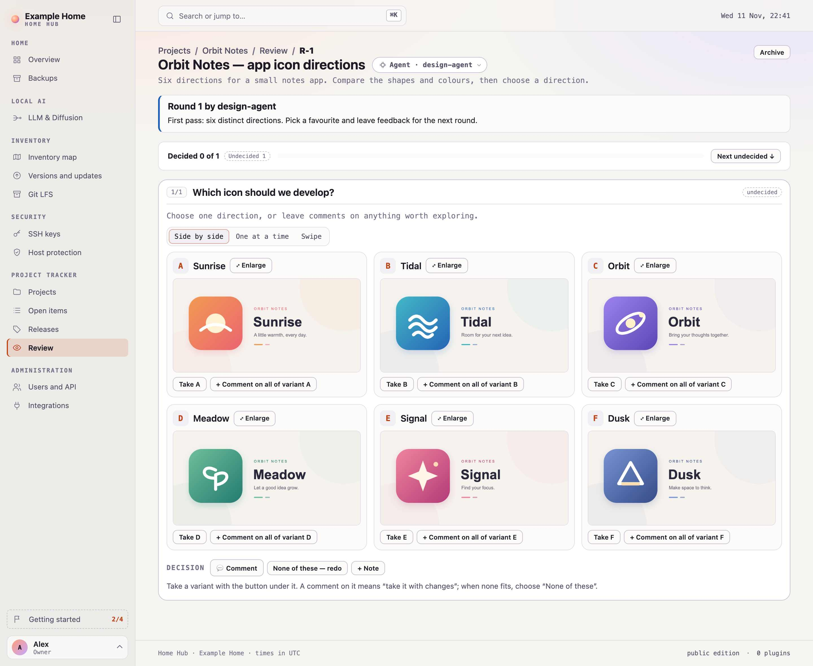

# Home Hub
<!-- home-hub:public-readme -->

Home Hub is a self-hosted hub for the machines of a home: how each machine is doing, what it runs, what depends
on it and what needs attention. Live telemetry, a services catalog, inventory, software versions, security checks
and local AI runtimes sit next to a project tracker and a review space.

It is built so your AI agent can do half the work. Agents read and update the same inventory through the HTTP
API and MCP endpoint, add machines and their runtime stacks, keep tickets and publish work for you to review.
**Integrations → Machines** shows what is connected on each machine and hands you a prompt for your agent to set
up the rest. Scoped service accounts decide what access it gets.

One Node process, zero third-party npm dependencies, a vanilla-JavaScript UI, and files you can back up.
A fresh public edition starts empty, with no household configuration or plugins.

## Screenshots

Examples from a configured hub, with identifying site and network labels replaced. Machine artwork and
project content are examples, not data bundled with a fresh installation.

**Overview — machine status, live telemetry and services at a glance.**


**Projects — work, activity and the next release in one place.**


**Review — an agent's variants side by side, for you to choose, comment on or send back.**



## Contents

[Quick start](#quick-start) · [Docker](#docker) · [Connect your agent](#connect-your-agent) · [Review](#review) ·
[What works out of the box](#what-works-out-of-the-box) · [Make it yours](#make-it-yours) ·
[Telemetry and LLM runtimes](#telemetry-and-llm-runtimes) · [Collectors and plugins](#collectors-and-plugins) ·
[Security model](#security-model) · [Running it for real](#running-it-for-real) · [Documentation](#documentation)

## Quick start

You need Node 22.13 or newer (a current patched release). There is no `npm install` step.

```sh
git clone <repository-url> home-hub && cd home-hub   # the URL from this repository's Code button
node scripts/setup.mjs                               # creates the administrator sign-in in private/
LOCAL_PREVIEW=1 PORT=8799 node server/index.mjs
```

Open http://127.0.0.1:8799 and sign in (default name `admin`). A new hub opens on **Getting started**, a
checklist that ticks itself as you go: connect an agent, add your machines, fill the inventory. Each step has a
ready prompt to hand to an agent; [docs/getting-started.md](docs/getting-started.md) has the same steps in detail.
`LOCAL_PREVIEW=1` is plain HTTP on this machine only; for the rest of your network see
[Running it for real](#running-it-for-real).

## Docker

```sh
export ORIGIN=https://hub.example.lan   # the HTTPS address your reverse proxy serves
docker compose up -d --build
docker compose exec hub node scripts/setup.mjs
```

The image is built from this checkout (no registry image, no npm install). Compose publishes HTTP on
**127.0.0.1:8781** for a TLS reverse proxy, and `ORIGIN` must match the browser's HTTPS origin exactly. There is
no default password. Back up all three volumes (`data`, `private`, `state`). [docs/docker.md](docs/docker.md)
covers the proxy, the volumes, mounting your `local/` overlay, collectors in a container and updates.

## Connect your agent

Agents use **service accounts**: a named identity with its own keys and scopes. In **Users and API → Service
accounts**, create one (for example `agent-laptop`) from a preset or with the scopes you pick (`read`, plus
`inventory:write`, `home:write` and so on), issue a key (`hhk_…`, shown once, stored as a hash) and give it to the agent:

```sh
# Claude Code
claude mcp add --transport http home-hub http://127.0.0.1:8799/mcp --header "Authorization: Bearer hhk_…"
```

```toml
# Codex: ~/.codex/config.toml
[mcp_servers.home-hub]
url = "http://127.0.0.1:8799/mcp"
http_headers = { Authorization = "Bearer hhk_…" }
```

The hub shows these snippets with your own address, plus the JSON for other MCP clients, on Getting started and
wherever a page is still empty. The agent sees only the tools its scopes allow (`home_status`, `machine_upsert`,
`inventory_update`, `ticket_create`, `review_publish` and more), and a short orientation when it connects.
**Users and API → Connect and API** lists every tool with its scope; the same key works on the HTTP API
([docs/API.md](docs/API.md)).

## Review

An agent working on your product puts its alternatives in Review: a character, a logo, a UI, a 3D model, music or
a video. You compare them side by side, take one, comment on a variant or ask for a redo; the agent reads that
back and submits the next round to the same review. With five or six alternatives this beats scrolling back and
forth through an agent chat. An item holds up to six variants: images, self-contained HTML mockups, `.glb`
models, video and audio.

1. The agent submits: `review_publish` (or `POST /api/review/publish`), with a service account that has `read`
   and `review:write`, into a project in the tracker.
2. You decide in the hub: take a variant, leave comments, or **None of these — redo**.
3. The agent reads it (`review_list` with `feedbackPending: true`, then `review_get`) and publishes the next round.

[docs/review.md](docs/review.md) covers pinned comments, comparison modes and uploads.

## What works out of the box

| Feature | Without anything else | Needs |
|---|---|---|
| Sign-in, roles, service accounts, API keys, access audit; getting-started checklist | Works | Nothing |
| Overview: a tile per machine | Empty, and says how to fill it | `local/site.json`, **Add device**, or an agent (`machine_upsert`) |
| Runtime stack on a machine page | Says how to publish one | An agent (`runtime_publish`) or `stack` in `site.json` |
| Live CPU, GPU, power, temperature, memory | Static facts, "telemetry not installed" | The telemetry agent, or agent-less Windows / Linux reads |
| Local LLM runtimes, what the GPU is generating | Not shown | A runtime the hub can reach, or a plugin |
| Inventory map, table and services catalog | Empty, with a template and an agent prompt | An agent (`inventory_update`) or you in the form |
| Versions, host protection, SSH keys, router census | Says what to configure and run | SSH access and a collector |
| Project tracker, review, full-text search | Works | Nothing |
| MCP endpoint and HTTP API | Works | A service-account key |
| Light and dark theme, English and Czech | Works | Nothing |
| Your own pages, routes and MCP tools | — | A plugin under `local/plugins/` |

Nothing in the list needs an npm package or a cloud service.

## Make it yours

Everything about your home lives in `local/`, which the hub reads at start and git ignores in a public checkout:

```sh
mkdir -p local && cp config/site.example.json local/site.json
```

Edit it and restart. Every field is optional, and a wrong one stops the server with a message that names it.

| Field | What it sets |
|---|---|
| `siteName` | The name in the sidebar, the page title and the installable-app name |
| `lanCidrs` | Your networks, for example `["10.0.0.0/24"]` |
| `timeZone`, `defaultLanguage` | The zone every time is shown in; `en` or `cs` until a browser chooses |
| `publicOrigin` | The address browsers use, for example `https://hub.example.lan` |
| `machines[]` | The machines on the overview: name, address, role, picture, hardware, how collectors reach them |
| `inventory.places[]`, `inventory.secretStores[]` | Your vocabulary for the inventory map |
| `tracker.projects[]` | Projects a new tracker starts with |
| `router` | Which router adapter feeds the client census |
| `runtimes[]` | Local LLM runtimes the hub reads directly: `{machine, kind, url, name?}` |
| `plugins.<id>` | Settings for a plugin |

[docs/plugins.md](docs/plugins.md) describes every field. Pictures in `local/images/` are served under `/images/`.

## Telemetry and LLM runtimes

**Telemetry (optional).** Live load, power draw and temperature come from a small telemetry agent on the machine
(Thermo), read over a pinned TLS connection. Its address is a placeholder until it has a public home:
`https://example.com/home-hub/telemetry-agent`. Other systems need no agent:

- **Windows:** in **Add device**, choose Windows and Telemetry → Windows (SSH), let the hub create its own key and
  run the one PowerShell step it shows. WinRM over HTTPS works too.
- **Linux:** Node Exporter (the hub reads `/metrics` on port 9100; no Prometheus server needed), a Prometheus you
  already run (one node_exporter target through `/api/v1/query`), or SSH with a fixed script that only reads
  `/proc`, `/sys` and `df`.
- Every machine says where its telemetry stands (not installed, unreachable, stale or fine); a failed read is never
  shown as "off", and without telemetry a tile shows the facts from your configuration.

**LLM runtimes.** The hub reads reachable runtimes itself every 30 seconds, read-only, and never loads, unloads or
prompts a model: llama-swap, Ollama, LM Studio, llama.cpp server, vLLM, SGLang, oMLX, mlx-serve and anything
OpenAI-compatible.

```json
"runtimes": [{"machine": "studio", "kind": "ollama", "url": "http://127.0.0.1:11434"}]
```

A machine page then shows each runtime with its models, which of them are generating or queued, and the processes
with the most GPU time. A runtime the hub cannot reach can come from a plugin or a small bridge on that machine.

The **LLM & Diffusion** page charts requests, tokens and tokens per second, and which clients sent them. For a
llama-swap the hub keeps that history itself: it reads the request log without emptying it, names each client from
the User-Agent in the access log (`claude-cli` is Claude Code, `codex` Codex), and stores request fields only,
never a prompt or a body, for 13 months.
[docs/features.md](docs/features.md#live-telemetry-optional) has the details of both.

## Collectors and plugins

Collectors are scripts you schedule. They read your machines over SSH, never install or change anything there, and
write files under `data/` that the hub serves:

```sh
node scripts/collect-systems.mjs        # OS and software versions, update candidates, host protection
node scripts/check-upstream.mjs         # newest upstream releases of the software you watch
node scripts/collect-security.mjs       # where SSH keys live and what they open
python3 scripts/collect-router-unifi.py # client census from a UniFi gateway
```

`scripts/systems/install-launchd.sh` schedules them on macOS; `examples/systemd/` has the same for Linux.

What only your home has goes into a **plugin**: `local/plugins/<id>/index.mjs` registers routes, scopes, MCP tools,
pages and sidebar entries through the same registry the core uses, and draws with the same UI pieces. The contract
is in [docs/plugins.md](docs/plugins.md); `tests/fixtures/plugins/demo/` is a complete small example.

## Security model

Home Hub is meant for a home network, not the open internet: keep it on your LAN or VPN.

- People sign in with a password and hold a role (Owner, Admin, Editor, Viewer or a custom set of scopes).
  Passwords are scrypt hashes; session cookies are HttpOnly and SameSite=Strict.
- Agents use service-account keys with scopes, and a plugin adds its own to the same table.

  | Scope | Allows |
  |---|---|
  | `read` | Every read endpoint except security (always included) |
  | `inventory:write` | Create and change inventory and service entries |
  | `home:write` | Machines on the overview, their runtime stacks, LLM runtime endpoints |
  | `home:settings` | The telemetry read interval |
  | `tickets:write` | Tickets, comments, releases, projects |
  | `review:write` | Publish review sets and store decisions |
  | `software:write` | The software watch list |
  | `security:read` | SSH key inventory, versions, host protection |

- **API keys never reach administration.** Users, roles, keys, service accounts and device tokens can be
  managed only from a browser signed in with a password; no scope opens those routes.
- Every write is checked by role or scope, and by revision or hash where it is stored. A stale write is refused.
- The inventory records where a secret is kept, never its value. Tokens and request bodies are never logged.
- A strict Content-Security-Policy, a same-origin check on every POST, and DOM built from text only.

More in [docs/features.md](docs/features.md#security-model).

## Running it for real

Put the hub behind a reverse proxy that terminates TLS, and tell it the address browsers use:

```sh
ORIGIN=https://hub.example.lan HTTP_BEHIND_PROXY=1 PORT=8799 BIND_HOST=127.0.0.1 node server/index.mjs
```

| Variable | Meaning | Default |
|---|---|---|
| `PORT` | Port to listen on | `8781` |
| `ORIGIN` | The origin browsers use; POSTs from anywhere else are refused | `publicOrigin` from `site.json`; with neither, the server does not start |
| `LOCAL_PREVIEW=1` | Plain HTTP on 127.0.0.1, for trying it out | off |
| `HTTP_BEHIND_PROXY=1` | Plain HTTP behind your TLS proxy | off: HTTPS with `TLS_KEY` / `TLS_CERT` |
| `BIND_HOST` | Address to bind | `0.0.0.0` (`127.0.0.1` in a preview) |
| `DATA_DIR`, `STATE_DIR`, `AUTH_FILE` | Collector output, the hub's own state, the administrator sign-in | `data/`, `data/state/`, `private/auth.json` |
| `HOME_HUB_SITE_CONFIG`, `HOME_HUB_PLUGINS_DIR` | Another site file or plugin directory; `none` for neither | `local/site.json`, `local/plugins/` |

State is one SQLite database and a few JSON files ([docs/storage.md](docs/storage.md)). Back up `data/` and
`private/`. To update, pull and restart: state migrates forward at start and sign-ins survive. There are no version
numbers; every page's footer shows the edition, the number of plugins and the commit that is running.

## Documentation

| Read | For |
|---|---|
| [docs/getting-started.md](docs/getting-started.md) | The first hour: install, sign in, connect an agent, add machines |
| [docs/features.md](docs/features.md) | Every part of the hub in detail: machines, inventory, tracker, access, telemetry, LLM runtimes, collectors, security |
| [docs/docker.md](docs/docker.md) | Docker in full |
| [docs/plugins.md](docs/plugins.md) | Site configuration, the plugin contract, the public export |
| [docs/API.md](docs/API.md) | The HTTP API, the UI manifest and the MCP tools |
| [docs/review.md](docs/review.md), [docs/storage.md](docs/storage.md), [docs/design.md](docs/design.md) | Review sets and uploads; where state lives; design tokens and UI components |
| [SPEC.md](SPEC.md), [AGENTS.md](AGENTS.md) | What it is, and the rules for changing it |

## Development

`npm test` runs every test in under ten seconds: the core on a generic fixture site, then your overlay's tests
when `local/` exists. No dependencies, no build step, no bundler: the browser loads `public/` as it is. UI text is
Czech in the code and translated in `public/i18n-en-*.js`; a test fails when a string has no English entry.
