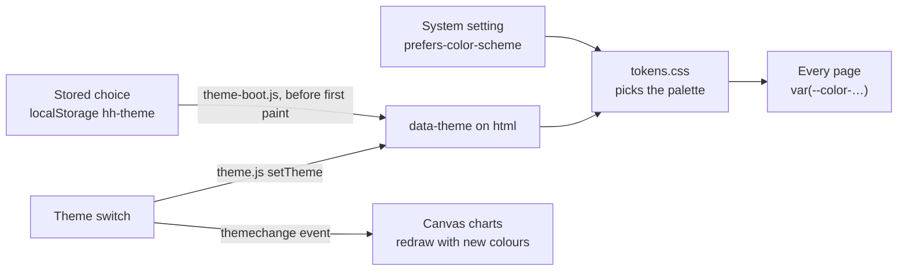
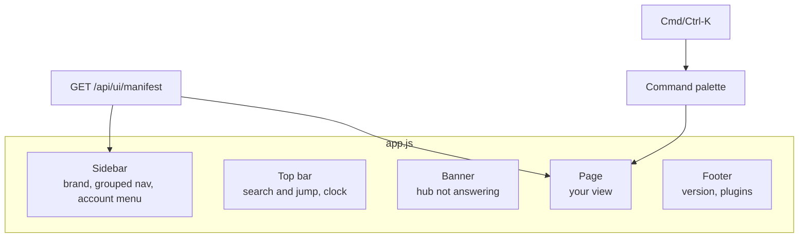

# Design system

How Home Hub pages get one look: the tokens in `public/tokens.css`, the components in `public/ui.js`, and
what the shell (`public/app.js`) gives every page. Core pages and plugin pages use the same pieces.

Three rules cover most of it:

1. **Use a token, not a value.** A colour, a gap, a radius or a font size written as a literal will be wrong
   in the other theme or drift from its neighbours.
2. **Use a component before you write one.** A page header, an empty state, a copy block, a toast: they
   exist, they are keyboard and screen-reader ready, and they change in one place.
3. **Build DOM from text.** `el()` from `public/views.js` puts strings into text nodes and attributes. No
   `innerHTML` from data, and no `style` attributes: the page's Content-Security-Policy refuses inline styles,
   so looks come from classes.

Token names and component signatures are a contract. Add to them; do not rename or remove.

## Themes

There are two palettes: dark ("nocturne": ink-violet night, warm paper text, peach accent) and light
("paper"). The page follows the system setting. A person can force one in the account menu, on the sign-in
card, or from the command palette; the choice is kept per browser.



- `public/theme-boot.js` is a classic script in `<head>`. It applies a stored choice before anything is drawn,
  so a forced theme never flashes the other one.
- `public/theme.js` is the module the UI uses: `getTheme()` → `'system' | 'light' | 'dark'`,
  `setTheme(next)`, `resolvedTheme()` → `'light' | 'dark'`. `setTheme` raises `themechange` on `window`.
- Anything that resolves colours itself (a chart on a canvas) should read them from the tokens with
  `getComputedStyle(document.documentElement).getPropertyValue('--color-text')` and redraw on `themechange`.
- Storage can be refused (private mode). The theme then simply follows the system.

## Tokens

### Colour

| Token | Use |
|---|---|
| `--color-bg`, `--color-bg-sunken` | The page; the sidebar and other recessed areas |
| `--color-surface` | Cards and panels |
| `--color-surface-sunken` | Inputs and code blocks inside a surface |
| `--color-surface-raised` | Hover, a selected segment, a heading strip |
| `--color-surface-overlay` | Things that float: menus, the palette, toasts |
| `--color-border`, `--color-border-strong` | Hairlines; borders of controls |
| `--color-text`, `--color-text-dim`, `--color-text-faint` | Body text; secondary text; labels and hints |
| `--color-accent`, `--color-accent-strong`, `--color-accent-text` | The one accent; its hover; text on it |
| `--color-accent-2` | The second accent (violet), for a second series or a quiet highlight |
| `--color-focus` | The focus ring |
| `--color-scrim` | The veil behind a dialog or the phone drawer |

Semantic colours say what something means. Each has a `-soft` partner: the tinted background for a pill, a
banner or a row.

| Meaning | Token | Soft background |
|---|---|---|
| ok, online, done | `--color-good` (alias `--color-ok`) | `--color-good-soft` |
| warning, stale, optional and missing | `--color-warn` | `--color-warn-soft` |
| error, offline, destructive | `--color-bad` (alias `--color-error`) | `--color-bad-soft` |
| information | `--color-info` | `--color-info-soft` |
| muted: unknown, not applicable | `--color-muted` | `--color-muted-soft` |
| accent | `--color-accent` | `--color-accent-soft` |

Text in every colour above reaches a contrast of at least 4.5 : 1 on the page and on a surface, in both
themes (`--color-text-faint` reaches 4.1 : 1 and is for labels, not for sentences). Do not signal a state by
colour alone: pair it with a word or a mark.

`--color-hover` is a faint tint of the text colour, for hover backgrounds on any surface.

### Spacing, radius, type

| Group | Tokens |
|---|---|
| Spacing (4 px grid) | `--space-0` 2 · `--space-1` 4 · `--space-2` 8 · `--space-3` 12 · `--space-4` 16 · `--space-5` 24 · `--space-6` 32 · `--space-7` 48 · `--space-8` 64 |
| Radius | `--radius-xs` 4 · `--radius-s` 6 · `--radius-m` 10 · `--radius-l` 16 · `--radius-xl` 22 · `--radius-pill` |
| Font | `--font-sans`, `--font-mono` |
| Size | `--text-2xs` 11 · `--text-xs` 12 · `--text-s` 13 · `--text-m` 15 · `--text-l` 18 · `--text-xl` 24 · `--text-2xl` 32 · `--text-3xl` 40 |
| Line height | `--leading-tight` 1.25 · `--leading-snug` 1.4 · `--leading-body` 1.5 |
| Weight | `--weight-regular` 400 · `--weight-medium` 550 · `--weight-semibold` 600 · `--weight-bold` 700 |
| Tracking | `--tracking-tight` for large titles · `--tracking-caps` for small capitals |

How type is used: page title `--text-xl` bold; section title `--text-l`; body `--text-m`; dense tables and
controls `--text-s`; labels in small capitals `--text-2xs` mono with `--tracking-caps`. Numbers that are
compared sit in `--font-mono`.

### Elevation, motion, focus, layers

| Token | Use |
|---|---|
| `--shadow-1` | A card resting on the page |
| `--shadow-2` (alias `--shadow-raised`) | A menu, a toast |
| `--shadow-3` | A dialog, the palette, the phone drawer |
| `--duration-fast` 120 ms, `--duration` 200 ms, `--duration-slow` 320 ms, `--ease-out` | Transitions. `prefers-reduced-motion` turns the shared animations off |
| `--focus-ring`, `--focus-width`, `--focus-offset` | `outline: var(--focus-ring); outline-offset: var(--focus-offset)`. The shell sets this for every `:focus-visible` |
| `--z-sticky` 5, `--z-nav` 30, `--z-overlay` 40, `--z-palette` 50, `--z-toast` 60 | Stacking order |
| `--sidebar-width`, `--sidebar-rail`, `--topbar-height`, `--gutter` | Shell measures. `--gutter` is the page's side padding |

### Older names

Page styles written before the tokens use short names. `public/hub.css` maps them onto the tokens, so those
pages follow the theme. New styles use the token names.

| Short name | Token |
|---|---|
| `--bg`, `--bg2` | `--color-bg`, `--color-bg-sunken` |
| `--panel`, `--panel2`, `--panel3` | `--color-surface`, `--color-surface-sunken`, `--color-surface-raised` |
| `--line`, `--line-hi` | `--color-border`, `--color-border-strong` |
| `--txt`, `--dim`, `--faint` | `--color-text`, `--color-text-dim`, `--color-text-faint` |
| `--accent`, `--accent2` | `--color-accent`, `--color-accent-2` |
| `--ok`, `--warn`, `--crit` | `--color-good`, `--color-warn`, `--color-bad` |
| `--mono`, `--sans` | `--font-mono`, `--font-sans` |

Two things to move when you touch such a file: a literal `rgba(255,255,255,…)` tint (use `--color-hover` or
a `-soft` token), and dark text written as a literal on an accent background (use `--color-accent-text`).

## Components

Import from `/ui.js` (a plugin imports by URL, as the browser sees it). Strings are shown as given: translate
them with `t()` at the call site.

```js
import {el} from '/views.js';
import {pageHeader, emptyState, toast} from '/ui.js';
import {t} from '/i18n.js';
```

### Page header

```js
pageHeader({eyebrow: t('Inventář'), title: t('Mapa inventáře'), lead: 'One sentence that says what this page is for.',
  back: {label: t('Přehled'), href: '#overview'},
  actions: [{label: 'Export', href: '/api/inventory/export'}, {label: 'Add', onclick: add, primary: true}]})
```

Every page starts with one. `eyebrow`, `lead`, `back` and `actions` are optional. An action is a link
(`href`) or a button (`onclick`); `primary`, `quiet` and `danger` choose its look.

`provenance` (the field of the same name in the page's data answer, `docs/API.md` → Provenance) adds a pill
next to the title: the kind of source ("Agent", "Collector · 2 days ago", "Mixed") in mono type, dashed while a
collector has not run, amber when its snapshot is stale or its last attempt failed. Pressing it opens the
breakdown: one row per source with its counts, accounts or people, script, schedule and when it last wrote.
`setProvenance(header, provenance)` fills or replaces it after the header is drawn; without data there is no pill.

### States: empty, not installed, error, loading

A page is never blank. It shows one of these until it has something to show.

```js
emptyState({icon: 'box', title: 'No entries yet', body: 'What belongs here, in one sentence.',
  steps: ['First do this.', 'Then this.'],
  agentPrompt: 'A ready prompt for a coding agent.',
  mcpSnippet: true,
  actions: [{label: 'Open the map', href: '#inventory-map', primary: true}]})

notInstalled({dependency: 'Thermo', installUrl: 'https://example.com/…',
  steps: ['Install it on the machine.', 'Add the machine on the Overview.']})

errorState({title: 'The inventory could not be loaded', body: 'What happened, if you know.', retry: () => load()})

disabledNotice(answer.disabled)            // an administrator turned the integration off: who, when, a link

loadingState('Loading the inventory…')      // a spinner and a line
skeleton(4)                                 // four grey lines in place of text
```

| Option | Meaning |
|---|---|
| `icon` | A name from `public/icons.js` (`box`, `archive`, `plug`, `cpu`, `shield`, `flag`, …) or a glyph |
| `steps` | Short lines, drawn as a numbered list. A line may be an array of strings and nodes |
| `agentPrompt` | Text for a coding agent, in a copy block |
| `mcpSnippet` | `true` shows how to connect an agent, as tabs for Claude Code, Codex and JSON. `{token, origin}` does the same with a real key. A string shows your own text |
| `compact` | A small dashed block, for an empty list inside a page that has other content |
| `optional` (`notInstalled`) | `false` hides the "Optional" tag |

Which one: nothing has been added yet → `emptyState`. An optional companion is missing → `notInstalled` (the
rest of the hub works, and it says so). The data's integration is turned off (the answer carries `disabled`) →
`disabledNotice`, never the old data. A request failed → `errorState` with `retry`. Still waiting →
`loadingState` or `skeleton`.

### Copy block, tabs, MCP snippet

```js
copyBlock('Prompt for an agent', text, {note: 'One line under the text.'})
copyButton(text)                              // only the button; text may be () => string
tabs({label: 'Connect', items: [{id: 'a', label: 'A', content: nodeOrFunction}], selected: 'a', onchange})
mcpConnect({token, origin})                   // the three connection snippets as tabs
mcpSnippets(token, origin)                    // → [{id, label, text}], if you draw them yourself
```

The Copy button turns into "Copied" with a tick for two seconds, or says that copying failed. Tabs follow the
arrow keys, Home and End.

### Small pieces

```js
statusPill('online', 'good')                  // tone: good | warn | bad | info | accent | '' | plain
banner({tone: 'warn', title: 'Stale.', body: 'Last read 2 hours ago.', actions: [{label: 'Refresh', onclick}]})
segmented({label: 'Range', options: [{id: '1h', label: '1 h'}, {id: '1d', label: '1 d'}], value: '1h', onchange})
themeSwitch()                                 // System | Light | Dark
icon('search')                                // an inline SVG in the text colour, 1em
```

Classes you can use directly: `ui-button` (with `primary`, `quiet`, `danger`, `small`), `ui-pill`, `ui-steps`
on an `<ol>`, `ui-sr` for text only a screen reader should get.

### Feedback: toasts and the loading bar

```js
toast('Saved.')                               // info
toast.good('Key revoked.')
toast.bad('The entry could not be saved.')    // stays longer, announced as an alert
toast('Entry removed.', {action: {label: 'Undo', onclick: undo}})

const done = startLoading();                  // the thin bar under the top edge
try { await save(); } finally { done(); }
await track(fetch('/api/…'));                 // the same for one promise
```

Use a toast for the result of something the person just did. Use `errorState` when a page cannot show its
content at all. The shell shows the loading bar by itself while a page module loads; call it for your own
slow actions. It appears only when the work takes longer than a blink.

## What the shell gives every page



- **Sidebar.** The site's name, then the groups and entries from the UI manifest, each with an icon. On a
  desktop it collapses to a rail of icons (the choice is kept per browser). Below 900 px it is a drawer opened
  from the top bar. A plugin's entry may name its icon: `icon: 'cpu'` (a name from `public/icons.js`) or a
  short glyph; without one it gets the first letter of its label.
- **Command palette** (Cmd-K or Ctrl-K, or the box in the top bar). Jump to any page this account may open,
  run a shell action (theme, language, collapse, sign out), open a machine, or search tickets and reviews.
- **Page title.** The browser tab says which page this is.
- **Focus and scroll.** When the page changes, the content starts at its top and the keyboard is at the
  content. A change inside a page (`#items` → `#items/HH-12`) leaves both alone.
- **Offline and stale.** When requests stop reaching the hub, a banner says that what is on screen was loaded
  earlier, and the page is drawn again when the hub answers.
- **A page that throws** while it draws is replaced by an error state with a retry; the shell stays.
- **Footer.** The version (`1.1.0`, or `1.1.0+dev` off a release tag; the commit and deploy time in its tooltip) and the
  number of plugins. An administrator also sees `→ 1.2.0`, a link to Integrations, while a newer release is known.

A page is one function, `(context) => Node`, with `context = {me, page, sub, machine, site}`. Register
listeners on `document` or `window` and timers with `onLeave()` from `/views.js`, so they go when the page
does.

### Widths

The UI works at 320, 768, 1024 and 1440 px. The shell changes at 900 px (drawer) and 600 px (tighter top
bar). Inside a page, let grids wrap with `minmax()` and give long values `overflow-wrap: anywhere`; a page
must never scroll sideways as a whole. Touch targets are at least 32 px, and 40 px for the main actions on a
phone.

### Language

UI strings are written in Czech in the code and looked up in `public/i18n-en-*.js` (`t('Přehled')` →
"Overview"). A plugin ships its own translations in its module's `strings`. `npm test` fails when a string in
`public/*.js` has no English entry.

## Checklist for a new or reworked page

- Starts with `pageHeader`.
- Has a loading, an empty and an error state.
- Uses tokens for every colour, gap, radius and font size.
- Looks right in light and in dark, at phone width and on a wide screen.
- Every control is reachable by keyboard and shows the focus ring.
- No state is told by colour alone.
- Strings go through `t()` and have English entries.
