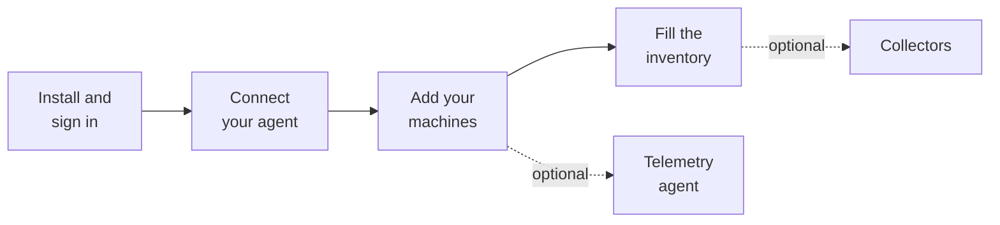

# Getting started

From an empty checkout to a hub that shows your home. Plan for about an hour, most of it your agent's.

The hub has the same list built in: after the first sign-in it opens **Getting started**, where each step
ticks itself once it is done. This page is the longer version, with what to expect at each step.



## 1. Install and sign in

You need Node 22.13 or newer and git. Nothing else: there are no packages to install.

```sh
git clone <this repository> home-hub && cd home-hub
node scripts/setup.mjs
LOCAL_PREVIEW=1 PORT=8799 node server/index.mjs
```

- `scripts/setup.mjs` creates the administrator sign-in. Only a hash of the password is stored, in
  `private/auth.json`. `private/` and `data/` are ignored by git; keep them out of any repository.
- The server prints one line when it is ready: `Home Hub (public edition, 0 plugin(s)) listening on 8799`.
- Open http://127.0.0.1:8799 and sign in as `admin`.

`LOCAL_PREVIEW=1` means plain HTTP, reachable from this machine only. That is the right way to try it. Step 7
covers serving it to your network.

What you see first: the Getting started page, and a sidebar whose pages are mostly empty. Each empty page says
what belongs there and how to fill it.

## 2. Connect your coding agent

This is the step that makes the rest quick. The agent will write your site file and fill the inventory.

1. Open **Users and API → Service accounts**. Create an account, for example `agent-laptop`.
2. Give it the scopes it needs. `read` is always there. Add `inventory:write` so it can maintain the
   inventory, and `tickets:write` if it should file tickets.
3. Issue a key. The key (`hhk_…`) is shown once. The hub keeps only its hash, so copy it now.
4. Copy the connection snippet for your agent from the same page, or from Getting started:

```sh
claude mcp add --transport http home-hub http://127.0.0.1:8799/mcp \
  --header "Authorization: Bearer hhk_…"
```

To check it, ask the agent to call `home_status`. The step ticks once a service account has a key, and shows
"connected" once that key has been used.

What a key can and cannot do: it reaches the endpoints and MCP tools its scopes allow. It can never manage
users, keys or service accounts, whatever its scopes. Disable or delete the account and every one of its keys
stops working at once.

## 3. Add your machines

Machines come from the site configuration, `local/site.json`.

```sh
mkdir -p local && cp config/site.example.json local/site.json
```

Edit the name, your network and your machines, then restart the hub. Or hand it to the agent. The Getting
started page has this prompt ready to copy:

> Set up this Home Hub. Read docs/getting-started.md, docs/plugins.md and config/site.example.json. Ask me
> for the site name, the network (CIDR), the time zone and the machines (name, hostname, IP, role). Write
> local/site.json, check it by running npm test, and tell me how to restart Home Hub. No passwords or tokens
> belong in that file.

A machine needs little:

```json
{"id": "studio", "name": "Mac Studio", "hostname": "studio.example.lan", "ip": "10.0.0.10", "role": "computer"}
```

`role` is `computer`, `nas`, `router` or `other`. Everything else (a picture, hardware facts, how collectors
reach it, a runtime stack to draw) is optional and described in [plugins.md](plugins.md). If a field is wrong,
the server does not start and names the field.

One device can also be added without the file: **Overview → Add device**.

## 4. Install the telemetry agent (optional)

Without it, a tile shows the facts from your configuration. With it, a tile shows live CPU and GPU load,
power draw, temperature and memory, and the machine's page draws their history.

The telemetry agent is Thermo, a small app that runs on the machine. Its address is in the README (a
placeholder for now). Install it, turn on its remote access, then either:

- use **Overview → Add device**, enter the machine's address and the agent's login, and confirm the
  certificate fingerprint the hub shows you, or
- set `thermoId` on the machine in `site.json` and list the host in `private/thermo-hosts.json`.

The hub only reads from it. Skip this step and nothing else changes.

A Windows machine needs no agent: in **Overview → Add device** choose the system Windows and Telemetry → Windows
(SSH). The dialog asks for host, SSH port and Windows user, creates the hub's own SSH key, shows the one
PowerShell step to run on Windows (and, when OpenSSH Server is not there yet, how to install it), lets you confirm
the host-key fingerprint and tests the connection. Nothing is set up on the machine that runs the hub, whatever
its system, beyond the OpenSSH client tools (`ssh` and `ssh-keyscan`). Windows can instead be read over WinRM
HTTPS (Telemetry → Windows (WinRM)); the dialog shows the explicit PowerShell step that adds an HTTPS listener and
enables Basic for the WinRM service only.

A Linux machine: choose the system Linux, then **Linux (Node Exporter)** (recommended; install Node Exporter with
your distribution's package or the official release, the dialog shows how, and allow port 9100 only from the hub),
**Linux (Prometheus)** when a Prometheus already scrapes the machine (the dialog lists its node_exporter targets;
pick exactly one), or **Linux (SSH)** (the hub's own key in `~/.ssh/authorized_keys` of a normal account; no sudo).
A machine you described in `site.json` (a NAS, say) is connected on its own page instead: **Telemetry settings**
opens the same steps, shows its name and address read-only, and stores only the connection; `site.json` is not
changed. A machine with `thermoId` keeps Thermo from the site files.
Prerequisites in short: Node Exporter ≥ 1.x with its default `cpu`, `meminfo`, `filesystem`, `diskstats`, `netdev`
collectors; Prometheus 2.x or 3.x with its HTTP API reachable from the hub; for SSH, `/bin/sh`, `df` and a readable `/proc`.

## 5. Fill the inventory

The inventory is one checked file, `data/knowledge.json`: machines, runtimes, tools and stores, and what
depends on what. The map and the services catalog are drawn from it. Secrets never go in: an entry says where
a secret is kept, not what it is, and the checker rejects anything that looks like one.

Do not type it by hand. Give the agent that works on each machine this prompt (also on the Getting started
page):

> You are connected to Home Hub over MCP. Go through this machine and record in the inventory what runs on
> it: use inventory_search to see what is already there, and inventory_update to add or correct entries (the
> machine, runtimes, tools, stores, ports, dependencies). For each one say how you verified it. Never write
> passwords or tokens, only where they are kept. When you are not sure, ask me.

Every write is checked. A stale write (someone else changed the entry first) is refused, and the agent reads
again and retries. Each write is logged with the account that made it.

## 6. Set up the collectors (optional)

Collectors read facts the hub cannot see from where it runs. They are scripts for a scheduler (cron, launchd,
a systemd timer). They connect over SSH and only read.

| Run | For | Needs |
|---|---|---|
| `node scripts/collect-systems.mjs` | OS and software versions, update candidates, host protection | An `ssh` entry per machine in `site.json` |
| `node scripts/check-upstream.mjs` | The newest upstream release of software you watch | Internet; the list in `local/software-watch.json` |
| `node scripts/collect-security.mjs` | Where SSH keys live and what they open | The same `ssh` entries |
| `python3 scripts/collect-router-unifi.py` | The router's client list | A UniFi gateway |

Until a collector has run, its page says which command to run.

## 7. Serve it to your network

`LOCAL_PREVIEW=1` is for one machine. For the rest of the house, put a reverse proxy with TLS in front and
tell the hub the address browsers will use:

```sh
ORIGIN=https://hub.example.lan HTTP_BEHIND_PROXY=1 PORT=8799 BIND_HOST=127.0.0.1 node server/index.mjs
```

- `ORIGIN` must be exactly what is in the browser's address bar. A sign-in from any other address is refused.
  You can set `publicOrigin` in `site.json` instead.
- Keep it on your LAN or VPN. Home Hub is not meant to face the internet.
- Run it under whatever keeps a process alive on your system, with the same environment each time.
- Back up `data/` and `private/`. That is all the state there is ([storage.md](storage.md)).

To update: `git pull`, then restart. Sign-ins survive the restart.

## When something is off

| You see | Look at |
|---|---|
| The server exits at start with `site config: …` | The field it names in `local/site.json` |
| The server exits with `module "…": …` | The plugin it names; [plugins.md](plugins.md) lists what is refused |
| Sign-in answers "Request not allowed" | `ORIGIN` does not match the address in the browser |
| A page says "Administrators only" | You are signed in as a viewer |
| A banner says the hub is not responding | The process stopped, or the proxy cannot reach it. The page redraws when it is back |
| The agent gets `SCOPE_REQUIRED` | Its service account lacks the scope the message names |
| The footer says `0 plugins` and you expected yours | `local/plugins/<id>/index.mjs` is missing or the directory name starts with `_` |

The footer of every page shows the edition, the number of plugins and the running commit. Include those three
when you report a problem.
