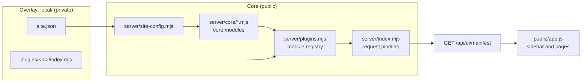

# Plugins and site configuration

Home Hub is a generic core plus whatever one household adds. The additions live in an overlay directory,
`local/`, in two forms:

- **`local/site.json`** — facts about the site: its name, network, machines. Core reads it.
- **`local/plugins/<id>/`** — features only this household has. Core loads them.

Core never imports from `local/`. A hub without `local/` works: it is empty and generic.



## Site configuration

Copy `config/site.example.json` to `local/site.json`. Every field is optional. `server/site-config.mjs`
validates the file at start-up: an unknown field or a wrong value stops the server with a message that names
the field. `HOME_HUB_SITE_CONFIG=/path/to/file.json` selects another file; `none` selects no file.

| Field | Meaning | Without it |
|---|---|---|
| `siteName` | Shown in the page title, the footer and the installable-app name | Just "Home Hub" |
| `lanCidrs` | Your networks, e.g. `["10.0.0.0/24"]`. The router adapter and machine descriptors keep only host addresses inside them | Any well-formed IPv4 address is accepted |
| `timeZone` | IANA zone for every time the UI shows | The browser's zone in the UI, the process zone on the server |
| `defaultLanguage` | `en` or `cs`: the language a browser starts in until its user picks one | `en` |
| `publicOrigin` | The origin browsers use, e.g. `https://hub.example.lan`. Used when `ORIGIN` is not set | `ORIGIN` must be set (a local preview is its own origin) |
| `machines[]` | The machines on the overview. See below | No tiles; add devices in the UI |
| `inventory.places[]` | `{id, label, short, column, lane}`: where inventory entries live. `column` gives the place its own column on the map, `lane` (`net` or `outside`) puts it in a shared one, `short` tags its cards. Order is column order | Every machine entry of the inventory gets a column of its own, named after it, next to Network and Outside |
| `inventory.secretStores[]` | Names of your secret stores (a password manager vault, …) that inventory entries may point at | Only the built-in ones: `passwords-app`, `remembered`, `unknown`, and the `keychain:` / `file:` / … prefixes |
| `tracker.projects[]` | `{id, key, name, type}`: projects a brand-new tracker starts with | The tracker starts with no projects |
| `security` | `gitHost` / `gitUrl` of a Forgejo the SSH-key collector should read, `certificates[]` (`{match, label}` names for TLS key files), `order[]` (machine order in the key list) | No git server is queried; TLS keys are labelled generically |
| `router` | `{adapter, host, site}`: the router feed. `adapter` is `unifi` (included) or the id of an adapter a plugin provides; `host` is the gateway the included collector reads (default: the machine with role `router`); `site` its UniFi site name | No router feed: the router tile and page say what to set up |
| `strings.en` | English for your own labels (the UI's source language is Czech): `{"source text": "translation"}` | Your labels show as written |
| `plugins.<id>` | Free-form settings for a plugin; core does not look inside | — |

A machine:

| Field | Meaning |
|---|---|
| `id` | Lowercase id (`a-z`, `0-9`, `_`, `-`), used in URLs (`#host-<id>`), data files and by the collectors |
| `name`, `hostname`, `ip` | What the tile shows |
| `role` | `computer`, `nas`, `router` or `other`. A `router` tile reads the router adapter's census; a `nas` tile is online when a plugin's service probes answer |
| `picture` | A path under `/images/` (yours go in `local/images/`) |
| `thermoId` | The host id in the Thermo hosts file. Set it and the tile shows live CPU, GPU, power, temperature and memory from the Thermo app. Thermo is optional: without it the tile is static |
| `hardware` | Static facts: `cpu`, `gpu`, `ramGb`, `diskTotalBytes`, `pools`, `wifi` |
| `ssh` | `{alias, probe, keys}`: how the collectors reach it. `alias` is an ssh config alias, or `local` for the machine the collector runs on. `probe` is `mac` or `nas` for `scripts/collect-systems.mjs`. `keys:false` leaves it out of `scripts/collect-security.mjs` |
| `stack` | The runtime grid drawn on the machine page: `{layers, cols, engines, blocks}` |

Pictures: any image under `local/images/` is served at `/images/<same path>`. The overview looks for
`/images/home/<machine id>.jpg`. The software watch list for the versions page is `local/software-watch.json`;
`config/software-watch.json` is an example to copy from, never the active list (`docs/API.md` → Software watch list).

## A plugin

A plugin is a directory `local/plugins/<id>/` with an `index.mjs` whose default export is a module object.
`<id>` must equal the object's `id`. Directories whose name starts with `_` or `.` are skipped.
`HOME_HUB_PLUGINS_DIR=/another/dir` loads from elsewhere; `none` loads nothing.

```
local/plugins/notes/
  index.mjs          the module definition (below)
  server/            its server code
  public/            its browser files, served at /plugins/notes/<file>
  scripts/           its command-line tools
  tests/*.test.mjs   run by npm test
```

The whole contract, with every field optional except `id`:

```js
export default {
  id: 'notes',                       // = directory name
  title: 'Notes',

  // Scopes this plugin adds to the service-account scope table.
  scopes: {'notes:write': {label: 'Poznámky – zápis', desc: 'Přidávat poznámky.'}},

  // Called once per hub. Returns the plugin's state; handlers get it as c.state. Must be synchronous.
  setup: hub => ({notes: []}),

  routes: [
    // GET: an API key needs "read" unless you say otherwise. Sign-in is required unless public: true.
    {method: 'GET', path: '/api/notes', handler: ({json, state}) => json(200, {notes: state.notes})},
    // A pattern instead of a path; params is the RegExp match.
    {method: 'GET', match: /^\/api\/notes\/(\d+)$/, handler: ({params, json, state}) => json(200, state.notes[params[1]])},
    // A write route must name its scope (or null: password sign-in only, never an API key).
    {method: 'POST', path: '/api/notes', scope: 'notes:write',
     handler(c) { c.state.notes.push(String(c.input.text)); c.subject = 'note'; return c.json(201, {ok: true}); },
     // What a thrown error means: [status, code, message], or nothing for a plain 500.
     error: e => e.message === 'invalid' ? [400, 'NOTES_FAILED', 'Invalid note.'] : null},
  ],

  // MCP tools, listed for keys that hold the scope. Throw toolError('…') (server/mcp.mjs) for a refusal.
  mcpTools: [{name: 'notes_list', scope: 'read', title: 'Notes', description: 'All notes.',
              inputSchema: {type: 'object', properties: {}, additionalProperties: false},
              run: (args, {state, principal, hub}) => ({notes: state.notes})}],

  // This plugin's lines in what an agent reads when it connects (the MCP initialize instructions).
  // One short text, or up to 6 parts; a part with a scope is said only to keys that hold that scope.
  mcpInstructions: ['Notes: notes_list returns every note.',
                    {scope: 'notes:write', text: 'With notes:write: POST /api/notes adds one.'}],

  // Background readers, started by the server after it listens.
  pollers: [{id: 'refresh', start: (state, hub) => {}, stop: state => {}}],

  // Files under public/, each served at /plugins/notes/<path>. Nothing else in the directory is reachable.
  assets: ['notes-view.js'],

  // Sidebar entries and pages. view = "<asset>#<export>"; the export is (context) => Node.
  nav: [{group: 'Notes', hash: 'notes', label: 'Notes', icon: 'list', view: 'notes-view.js#notesPage', order: 60}],

  // English for this plugin's Czech source strings (labels above, messages it sends).
  strings: {en: {'Poznámky – zápis': 'Notes – write', 'Přidávat poznámky.': 'Add notes.'}},

  // Rows for the API reference on the Users and API page.
  apiDocs: [{title: 'Notes', routes: [['GET', '/api/notes', 'read', 'All notes.']]}],

  // Extension points of core (see below).
  provides: {},
};
```

A complete small example that the test suite loads is `tests/fixtures/plugins/demo/`.

### Routes

A handler gets one context object:

| Field | |
|---|---|
| `req`, `res`, `url`, `pathname`, `query` | The request; `query` is the search parameters as an object |
| `params` | The match of a `match` route, else `null` |
| `input` | The parsed JSON body of a POST |
| `principal` | Who is calling: `{id, username, role, permission, authKind, scopes}` (`session`, `device` or `api-key`). `scopes` is what the caller holds: a person's role, a key's account, everything for a device. `role` is `admin` for an administrator (the owner included), else the role id; `roleId` is the exact role |
| `canWrite`, `canAdmin`, `signedIn`, `device` | Shortcuts |
| `json(status, data)`, `error(status, code, message)` | Replies |
| `state` | What this module's `setup` returned |
| `hub` | The hub: `site`, `directory` (data), `stateDirectory`, `db`, `auth`, `accessStore`, `registry`, `options`, `state(id)`, `collect(name)`, `provided(name)` |
| `subject` | Set it to what a write touched; it goes into the API write log |

The pipeline does the common checks before your handler runs, in this order: the credential, admin-only path
prefixes, the API key's scope, the `Origin` and `Content-Type` of a browser POST, sign-in, write permission, the
scope of a signed-in person's role, the body size limit, JSON parsing. A route's `scope` therefore holds for
everyone: a key, a person (through their role) and a device.

| Route field | Default | Meaning |
|---|---|---|
| `method` | — | `GET`, `POST` or `PUT` |
| `path` \| `match` | — | An exact path, or a RegExp (no `g`/`y` flag). An exact path wins over a pattern |
| `scope` | `read` for GET; required otherwise | The scope an API key needs; `null` = never with an API key |
| `public` | `false` | No sign-in needed |
| `write` | `true` for non-GET routes whose scope is not `read` | The caller needs write permission |
| `head` | `false` | Also answer HEAD (GET routes) |
| `bodyLimit` | `16384` | Largest POST body in bytes |
| `parse` | `true` | Parse the POST body as JSON |
| `raw`, `contentType`, `denied` | — | A PUT upload: the handler reads `req` itself; `contentType` is required exactly; `denied` replaces the read-only message |
| `error` | — | `(error, context) => [status, code, message]` for errors the handler throws |

### What is refused at start-up

The server does not start when a plugin is wrong. The message names the plugin and, for a clash, both sides.

- An unknown field, a missing `handler`, a write route without `scope`, a `view` that is not in `assets`,
  an asset path with `..`, an asset file that does not exist.
- Two modules registering the same route (method + path, or method + the same pattern), scope id, page hash,
  MCP tool name, asset URL or module id. Core modules count: a plugin cannot take `/api/home`.
- A route, tool, page or `mcpInstructions` part using a scope that no loaded module defines.
- An `mcpInstructions` text that is empty, longer than 600 characters or more than one line.

A plugin may use a core scope (`read`, `tickets:write`, …) or another plugin's.

### Extension points

`provides` adds to a core feature without touching it. Each provider is `(state, hub) => value` (a promise is
fine).

| Name | Value | Used by |
|---|---|---|
| `home.snapshots` | `{machineId: {snapshot, bridge}}` — what an agent on the machine reports: `snapshot.services[]`, `memory`, `uptimeSeconds`, `collectedAt` | Overview tiles and the machine page stack |
| `home.services` | `{machineId: services[]}` — reachability probes for a machine without an agent (role `nas`) | The NAS tile's online state and service list |
| `home.runtimes` | `{machineId: {source, observedAt, runtimes: [{id, name, kind, status: running\|stopped\|unknown, url, version, models: [{id, state, sizeGb}], stats: [{label, value}]}]}}` — local LLM runtimes on a machine (llama-swap, Ollama, LM Studio, llama.cpp, vLLM, …). Core bounds it (20 runtimes, 30 models, 12 stats each) and never interprets it | The "Local LLM runtimes" section of a machine page; without a provider it says it needs the telemetry agent |
| `inventory.writer` | `{put(change, by), edit(input)}` or `null` — where inventory edits go instead of the local file. Optional: `remove(change)` and `bulk(change, {by, user})`; without them delete and bulk upsert answer `501` | Inventory map and services catalog |
| `router.adapter` | `{id, title, read(context)}` — another router's census and health. `read` resolves to an observation `{status, observedAt, model, firmware, routerMac, devices[], hardware[]}` or `null`; core validates and bounds it (`server/router-data.mjs`). Optional `staleAfterSeconds` | `GET /api/router`, the router tile and page |

Plugins can define their own names for each other: `hub.collect(name)` returns every provider's value,
`hub.provided(name)` the first.

### The router adapter

The census of network clients and the router's health come from one adapter. UniFi is included: schedule
`python3 scripts/collect-router-unifi.py` every minute (it reads the gateway with GET requests only, pins its
certificate, and writes `data/router-observations.json`) and set `"router": {"adapter": "unifi"}` in `site.json`.
The collector takes the gateway and the networks from the same file (`router.host`, `lanCidrs`).

For another router, a plugin provides the adapter and `site.json` names it:

```js
provides: {'router.adapter': (state, hub) => ({id: 'mikrotik', title: 'MikroTik',
  read: async ({site, directory}) => ({status: 'ok', observedAt: new Date().toISOString(), model: 'hEX', firmware: '7.16',
    devices: [{mac: 'aa:bb:cc:dd:ee:01', ip: '10.0.0.20', name: 'printer', connection: 'Ethernet', presence: 'reachable'}],
    hardware: [{name: 'hEX', model: 'RB750', state: 'ONLINE', firmware: '7.16', ip: '10.0.0.1'}]})})},
```

`connection` is `Ethernet`, `Wi-Fi` or `Wi-Fi · 2.4 GHz` / `5 GHz` / `6 GHz`; `presence` is `associated`, `reachable` or
`lease-only`. Return `{status: 'unavailable', error: 'short-code'}` when a read fails, and `null` when nothing has
been observed yet. A `read` must only read: an adapter never changes anything on the router.

### The browser side

`GET /api/ui/manifest` describes the shell to the browser: the site (`name`, `timeZone`, `defaultLanguage`),
the edition, and for a signed-in caller the pages it may open, the sidebar groups, the loaded modules, extra
strings, API docs and the MCP tools (`docs/API.md` → The UI manifest has every field). Entries the caller may not open (`admin: true`, or a `scope` their role lacks) are left
out, and the router refuses those pages too. Before an owner account exists it also carries `setupRequired: true`.

The shell around your page (sidebar, command palette, toasts, the loading bar, light and dark theme) and the
building blocks for the page itself are described in [design.md](design.md). A plugin page that uses the
tokens and `ui.js` follows the theme and looks like the core pages without any CSS of its own.

A page module exports one function per page: `(context) => Node`, with
`context = {me, page, sub, machine, site}` (`#notes/42` gives `page: 'notes'`, `sub: '42'`). Import core helpers
by URL, as the browser sees them:

```js
import {el} from '/views.js';
import {pageHeader, emptyState, errorState, loadingState, toast} from '/ui.js';
import {t} from '/i18n.js';

export function notesPage({me}) {
  const list = el('div', {}, loadingState('Loading notes…'));
  fetch('/api/notes').then(r => r.json()).then(({notes}) => list.replaceChildren(...(notes.length
    ? notes.map(note => el('p', {}, note))
    : [emptyState({icon: 'list', title: 'No notes yet', body: 'Add the first one, or let your agent do it.', mcpSnippet: true})])))
    .catch(() => list.replaceChildren(errorState({title: 'Notes could not be loaded', retry: () => location.reload()})));
  return el('div', {}, pageHeader({eyebrow: 'Notes', title: 'Notes', lead: `Signed in as ${me.username}.`,
    actions: [{label: 'Add', primary: true, onclick: () => toast.good('Added.')}]}), list);
}
```

Every page gets the three states: loading, empty and error. `emptyState` with `mcpSnippet: true` shows how to
connect an agent, with a copy button per client.

Nav entry fields: `group` / `groupKey` (sidebar heading; `…Key` is Czech source text passed through `t()`),
`label` / `labelKey`, `hash`, `view`, `order` (core uses 10–50), `admin`, `scope`, `hidden` (routable, not in the
sidebar), `soon` (a faded placeholder with no page), `icon` (the entry's mark in the sidebar and the command
palette: a name from `public/icons.js` such as `cpu`, `box`, `list`, `shield`, or a short glyph; without it the
entry shows the first letter of its label). `admin: true` restricts a page to administrators;
`scope: '<scope id>'` opens it to administrators and to any role that holds that scope (use the scope its
data route needs). In the manifest a page this caller may not open is listed with `admin: true` and no view.

Styles: use the design tokens (`var(--color-surface)`, `var(--space-4)`, …), never literal colours, or the
page will be wrong in one of the two themes. The page's Content-Security-Policy refuses inline `style`
attributes, so use the `ui-*` classes, or put your own rules in a stylesheet listed in `assets` and link it
once from your view: `document.head.append(el('link', {rel: 'stylesheet', href: '/plugins/notes/notes.css'}))`.

Build text-safe DOM only: `el()` puts strings into text nodes and attributes. Never assign `innerHTML` from data.

### Tests

Put them in `local/plugins/<id>/tests/*.test.mjs`. `npm test` runs them after the core tests, with your
`site.json` and all your plugins loaded. A test builds a hub with `createHandler` from `server/index.mjs` and
passes fakes through its options (they arrive as `hub.options`); `tests/hub-helper.mjs` has a ready helper.
Under the test runner, front-end modules can be imported in Node with the same URL-style imports.

## Editions and the public export

`edition.json` at the repository root says `private` (the tree with an overlay) or `public` (an export).
`server/edition.mjs` exposes `readEdition()` and `isPublicRelease()`; `HOME_HUB_EDITION` overrides the file in
tests. The server prints the edition and the number of plugins when it starts. Behaviour does not branch on the
edition: a public tree is simply one without `local/`.

```bash
node scripts/leak-scan.mjs                    # list household details in the files an export would include
node scripts/export-public.mjs <outDir>       # copy the core tree, write edition public and the public README
node scripts/publish-public-branch.mjs        # commit that export onto the local orphan branch "public"
```

The export copies tracked files outside `local/`, `private/`, `data/`, `state/`, `router-private/` and
`deploy/`. Its README is the repository's `README.md` without the sections between `<!-- private:begin -->`
and `<!-- private:end -->` (a README that does not carry `<!-- home-hub:public-readme -->` is not used at all,
and a short generic one is written instead). It refuses, with a non-zero exit code, when the scan finds the owner's name, the home subnet, a home
path, the site name, the home domain or an e-mail address outside the placeholder domains.
`tests/leak.test.mjs` runs the same scan in `npm test`. Neither script pushes anything.
