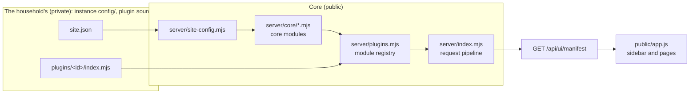

# Plugins and site configuration

Home Hub is a generic core plus whatever one household adds. The additions come in two forms:

- **`site.json`** — facts about the site: its name, network, machines. Core reads it.
- **plugins** — features only this household has, each a directory with `plugin.json` and `index.mjs`. Core loads them.

Both live apart from the code: the site file in an instance's `config/` (`HOME_HUB_HOME`, `docs/storage.md`) and
the plugins in plugin sources of their own, usually a private repository ([Where plugins are](#where-plugins-are)).
The overlay directory `local/` of the core checkout (`local/site.json`, `local/plugins/<id>/`) still works as the
default, deprecated until 2.0 removes it. Core never imports from a plugin; a plugin imports core only by name
([Importing core](#importing-core)). A hub without either works: it is empty and generic.



## Site configuration

Copy `config/site.example.json` to `local/site.json`. Every field is optional. `server/site-config.mjs`
validates the file at start-up: an unknown field or a wrong value stops the server with a message that names
the field. `HOME_HUB_SITE_CONFIG=/path/to/file.json` selects another file; `none` selects no file.

| Field | Meaning | Without it |
|---|---|---|
| `siteName` | Shown in the page title, the footer and the installable-app name | Just "Home Hub" |
| `lanCidrs` | Your networks, e.g. `["10.0.0.0/24"]`. The router adapter and machine descriptors keep only host addresses inside them | Any well-formed IPv4 address is accepted |
| `timeZone` | IANA zone for every time the UI shows | The browser's zone in the UI, the process zone on the server |
| `defaultLanguage` | `en` or `cs`: the language a browser starts in until its user picks one | `en` |
| `publicOrigin` | The origin browsers use, e.g. `https://hub.example.lan`. Used when `ORIGIN` is not set | `ORIGIN` must be set (a local preview is its own origin) |
| `machines[]` | The machines on the overview. See below | No tiles; add devices in the UI |
| `inventory.places[]` | `{id, label, short, column, lane}`: where inventory entries live. `column` gives the place its own column on the map, `lane` (`net` or `outside`) puts it in a shared one, `short` tags its cards. Order is column order | Every machine entry of the inventory gets a column of its own, named after it, next to Network and Outside |
| `inventory.secretStores[]` | Names of your secret stores (a password manager vault, …) that inventory entries may point at | Only the built-in ones: `passwords-app`, `remembered`, `unknown`, and the `keychain:` / `file:` / … prefixes |
| `tracker.projects[]` | `{id, key, name, type}`: projects a brand-new tracker starts with | The tracker starts with no projects |
| `security` | `gitHost` / `gitUrl` of a Forgejo the SSH-key collector should read, `certificates[]` (`{match, label}` names for TLS key files), `order[]` (machine order in the key list) | No git server is queried; TLS keys are labelled generically |
| `runtimes[]` | `{id?, machine, kind, url, name?}`: local LLM runtimes the hub reads directly (core module `runtimes`). `machine` is a machine of this file; `kind` is `auto` (detected) or one of `llama-swap`, `ollama`, `lmstudio`, `llama-cpp`, `vllm`, `sglang`, `omlx`, `mlx-serve`, `openai`; `url` is an origin only (`http://127.0.0.1:11434`): no path, no user or password, an IP address on loopback or inside `lanCidrs` (any private range when `lanCidrs` is empty). `id` defaults to `<machine>-<port>`. At most 40, each URL once. Entries added through the API live in `state/runtimes-config.json`; these are read-only there | No direct reads; a plugin may still provide `home.runtimes` |
| `runtimeClients` | `{"<User-Agent family>": "<client name>"}`: what the runtime request history calls a client, by the first word of its User-Agent (`deno`, `python-httpx`, …), matched without regard to case. Wins over the generic names in `server/runtime-history.mjs` (`claude-cli` → Claude Code, `codex` → Codex, …). At most 60; a family is letters, digits and `._+-` (≤ 40), a name ≤ 60 characters. Applies to stored history too: the name is looked up when the history is read | The generic names; an unknown family is shown as itself |
| `router` | `{adapter, host, site}`: the router feed. `adapter` is `unifi` (included) or the id of an adapter a plugin provides; `host` is the gateway the included collector reads (default: the machine with role `router`); `site` its UniFi site name | No router feed: the router tile and page say what to set up |
| `updates` | `{repo, channel, intervalHours}`: the update check. `repo` follows another GitHub repository's releases (`"owner/name"`, for a fork), `channel` is `stable` or `prerelease`, `intervalHours` is 6 to 168 | The repository in `package.json → homeHub.updates.repo`, stable releases, every 12 hours |
| `strings.en` | English for your own labels (the UI's source language is Czech): `{"source text": "translation"}` | Your labels show as written |
| `plugins.<id>` | Settings for a plugin. Core checks only that the keys its `plugin.json → config.required` names are there; the plugin validates the values | — |

A machine:

| Field | Meaning |
|---|---|
| `id` | Lowercase id (`a-z`, `0-9`, `_`, `-`), used in URLs (`#host-<id>`), data files and by the collectors |
| `name`, `hostname`, `ip` | What the tile shows |
| `role` | `computer`, `nas`, `router` or `other`. A `router` tile reads the router adapter's census; a `nas` tile is online when a plugin's service probes answer |
| `picture` | A path under `/images/` (yours go in `local/images/`) |
| `thermoId` | The host id in the Thermo hosts file. Set it and the tile shows live CPU, GPU, power, temperature and memory from the Thermo app. Thermo is optional: without it the tile is static, or the owner connects an agent-less source on the tile (below) |
| `platform` | Optional: `macos`, `windows`, `linux` or `other`. Limits the agent-less sources offered on the tile to that system's; without it every one is offered |
| `hardware` | Static facts: `cpu`, `gpu`, `ramGb`, `diskTotalBytes`, `pools`, `wifi` |
| `ssh` | `{alias, probe, keys}`: how the collectors reach it. `alias` is an ssh config alias, or `local` for the machine the collector runs on. `probe` is `mac` or `nas` for `scripts/collect-systems.mjs`. `keys:false` leaves it out of `scripts/collect-security.mjs` |
| `stack` | The runtime grid drawn on the machine page: `{layers, cols, engines, blocks}` |

A machine without `thermoId` that is not the router can be read without an agent (Windows over SSH or WinRM, Linux
over Node Exporter, Prometheus or SSH): its page has **Telemetry settings** for an account with write access signed
in with a password. Only the connection is stored, in the hub's state (`state/home/site-telemetry.json` and the
private connection files); this file is never written and the machine stays read-only everywhere else
(`docs/API.md` → Agent-less telemetry). Its name, hostname, ip, hardware and picture can be overridden on its tile
(**Edit**, stored in `state/home/site-overrides.json`); collectors and plugins keep reading the values of this file.

Pictures: any image under `local/images/` is served at `/images/<same path>`. The overview looks for
`/images/home/<machine id>.jpg`. The software watch list for the versions page is `local/software-watch.json`;
`config/software-watch.json` is an example to copy from, never the active list (`docs/API.md` → Software watch list).

## A plugin

A plugin is a directory `<plugins>/<id>/` with an `index.mjs` whose default export is a module object, and a
`plugin.json` that says what it is (below). `<id>` must equal the object's `id`. Directories whose name starts
with `_` or `.` are skipped. Where `<plugins>` is: [Where plugins are](#where-plugins-are); by default
`local/plugins/`.

```
local/plugins/notes/
  plugin.json        its version, the core range it supports, what it needs (read before any code runs)
  index.mjs          the module definition (below)
  server/            its server code
  public/            its browser files, served at /plugins/notes/<file>
  scripts/           its command-line tools
  tests/*.test.mjs   run by npm test
```

### plugin.json

```json
{
  "id": "notes",
  "version": "1.0.0",
  "title": "Notes",
  "core": ">=1.2.0 <2.0.0",
  "requires": {"compute": ">=1.0.0"},
  "dataEpoch": 1,
  "config": {"required": ["hosts"]},
  "hostAgents": [{"id": "bridge", "title": "Host bridge", "entry": "scripts/bridge.mjs", "service": "launchd-agent",
                  "health": {"socket": "private/bridge.sock", "get": "/status"}}]
}
```

| Field | Meaning |
|---|---|
| `id` | Equals the directory name and `index.mjs`'s `id` |
| `version` | The plugin's semver. Optional when its source's `package.json` has a `version`: the plugin then has the source's |
| `title` | Optional; for people |
| `core` | The Home Hub versions it supports: comparators joined by spaces (`>=1.2.0 <2.0.0`), `^1.2.0`, `~1.2.0`, `1.x`, `*`, and `a \|\| b` for either (`server/semver.mjs`). Optional when the source's `package.json` has `homeHub.core` |
| `requires` | Other plugins it needs, each with a range. Use it instead of importing another plugin silently |
| `dataEpoch` | A positive integer you raise whenever the plugin's own stored format changes |
| `config.required` | Keys of `site.json → plugins.<id>` it cannot work without; a missing one stops the start, by name. Checking the values stays the plugin's job, in `setup` |
| `hostAgents` | Code the plugin runs as a service on another machine ([Host agents](#host-agents)): `id`, `title`, `entry` (a `.mjs` file in the plugin), `service` (`launchd-agent`, `launchd-daemon` or `systemd-user`), `health` (`socket` relative to the agent's directory, and a `get` path it answers), `config` (a module of the plugin that says what the agent needs to know). Nothing about one household goes here: no label, path or machine; that is configuration |

An unknown field, a wrong value, a core range this core is outside of, an unmet `requires` or a missing required
setting stops the start with the plugin's name (`node server/index.mjs --check` runs every one of these checks and
exits, opening nothing). A plugin **without** `plugin.json` still loads in 1.x, with one warning line (an
"unversioned plugin"); 2.0 will require it. The start-up line names every plugin with its version
(`Home Hub 1.2.0 (… 9 plugin(s): compute 1.0.0, …)`), and so do `GET /api/ui/manifest → modules[]` and the footer's
tooltip.

### Importing core

A plugin imports core **by name**, never by a relative path into the core tree:

```js
import {tx, provenance, toolError} from 'home-hub/plugin-api';    // server code, scripts, host agents
import {hub, createHandler, hashPassword} from 'home-hub/testing'; // tests
```

| Export | What it has |
|---|---|
| `home-hub/plugin-api` (`server/plugin-api.mjs`) | `tx`, `sentences` (text to translate), `worstState` (integrations), `provenance`, `authoredProvenance`, `collectorSource`, `toolError` (MCP refusals), `byteRange` (Range requests), `readRouter`, `mergeRouter` (the router census), `createKnowledgeEditor`, `entryHash`, `validateKnowledge` (the inventory file), `satisfies`, `validRange`, `compareVersions`, `parseVersion` (semver), `site`, `loadSite` (the site configuration, for a plugin's scripts), `resolvePaths` (where data and secrets are), `CORE_VERSION` |
| `home-hub/testing` (`tests/plugin-testing.mjs`) | `createHandler`, `buildRegistry`, `STARTUP_PLUGINS`, the `hub(t, options)` helper with `credentials` and `knowledge`, `hashPassword`, `createAuth`, `createAccessStore`, `SCOPES`, `scopeFor`, `legacyScopes`, `site`, `loadSite`, `validateSite`, `machineKind`, `sshHosts`, the front-end test hook `BROWSER_PATHS_HOOK`, `CORE_FIXTURES`; and what a household's tests check their data against: `readEdition`, `homeDefinitions`, `stackLayouts`, `systemMachines`, `buildSystems`, `parseSystemsProbe`, `liveState`, `placements`, `buildGraph`, `cleanRequest`, `READ_PATHS`, `EVENT_PATH`, `walkKnowledge`, `findKnowledge`, `loadKnowledge`, `validStore`, `storeNames`, `softwareWatchPath` |

These two files **are** the server-side plugin contract and fall under semver; anything not exported there is
internal and may change in any release. The browser side is unchanged: page modules import `/views.js`, `/ui.js`,
`/i18n.js` by URL, and a test imports a core browser module the same way (`await import('/i18n.js')`) under the
test runner's front-end hook.

How the name resolves, with nothing installed:

- **A plugin inside the core tree** (`local/plugins/…`): Node's package self-reference. The nearest `package.json`
  above the plugin is core's, named `home-hub`, and its `exports` map the two names.
- **A plugin anywhere else**: one link, `node_modules/home-hub → <core checkout>`, in a directory above it (the
  instance directory, or the plugin source). `node scripts/plugins.mjs link [--plugins DIR] [--at DIR]` makes it;
  `node scripts/plugins.mjs list` shows every plugin directory, its plugins with versions, and which core the name
  resolves to there. Node resolves the link to its real path, so the plugin gets the very modules core runs with.

At start-up core checks it: if `home-hub` resolves from a plugin directory to **another** core (a link left pointing
at an old checkout), the hub refuses to start and prints the `link` command, because two copies of core in one
process would each keep their own state. A plugin that imports the name where it does not resolve fails to load
with the same hint. The link points at core itself: no third-party package, no `npm install`.

### Host agents

A **host agent** is the part of a plugin that runs as a service on another machine than the hub (a bridge to that
machine's runtimes, say). The plugin declares it in `plugin.json → hostAgents`; the household says where it runs, in
`site.json → plugins.<plugin>.agents.<agent>.<machine>`:

```json
"plugins": {"notes": {"agents": {"bridge": {"studio": {
  "target": "~/agents/notes", "label": "com.example.notes-bridge", "node": "/opt/homebrew/bin/node",
  "env": {"NOTES_MODE": "live"}, "logs": "~/Library/Logs/notes"}}}}}
```

`node scripts/install-host-agent.mjs --plugin notes --agent bridge`, run **on that machine** (the hub never pushes code
to another host), installs or updates it: `--dry-run` prints the change, `--target` and `--label` make a side-by-side
test install, `--no-service` only lays the files out. It

- copies the agent's import closure (`server/agent-closure.mjs`: the entry and everything it imports, following
  `home-hub/*` through core's `exports`) as real files: plugin files at their path in the plugin source
  (`<target>/plugins/<id>/…`, `<target>/lib/…`), core files under `<target>/node_modules/home-hub/`, so the agent runs
  with no checkout and no link. Files with uncommitted changes are refused;
- writes the agent's configuration, what the plugin's `config` module (`({site, machine}) => object`) returns, to
  `<target>/config/<agent>.json` (0600), and `<target>/.agent-install.json`: the plugin and its version, the core
  version, both commits, every file with its sha256. Files the previous record listed and the new one does not are removed;
- archives the previous copy and service file, writes the service (a launchd agent or daemon, or a systemd user unit,
  from `scripts/host-agent/`) with `HOME_HUB_HOME=<target>` and `HOME_HUB_AGENT_SOCKET=<target>/<health.socket>`,
  restarts it and waits for the health `GET` to answer; otherwise it puts the archive back and starts the previous agent.

The agent reads its configuration from `resolvePaths().config` and says what it is with `installedAgent()` (both from
`home-hub/plugin-api`); a plugin that shows this on its integration card ("the bridge runs 1.0.0, the hub has 1.1.0")
has the update check for host agents, derived locally with no network.

### Where plugins are

| In this order | Plugin directories |
|---|---|
| `HOME_HUB_PLUGINS_DIR` | One or more directories separated by `:` (`;` on Windows); `none` loads nothing |
| `HOME_HUB_HOME/instance.json` | `{"sources": {"plugins": ["household"]}}` → `<home>/household/plugins` for each name. The same file tells the update command where core is and how the service is stopped, started and checked (`sources.core`, `service`, `health`, `backups`: `docs/updating.md`); the server only checks that those are well formed |
| otherwise | `local/plugins/` in the core checkout (deprecated in 1.2, removed in 2.0) |

A plugin id is unique across all of them. A **plugin source** is a directory that holds `plugins/` and a
`package.json` of its own, `{"name", "version", "homeHub": {"core": "<range>"}}`: its version and core range are
the defaults of the plugins in it that state none, and its name is the `source` the manifest reports.

### The module object

The whole contract, with every field optional except `id`:

```js
export default {
  id: 'notes',                       // = directory name
  title: 'Notes',

  // Scopes this plugin adds to the service-account scope table.
  scopes: {'notes:write': {label: 'Poznámky – zápis', desc: 'Přidávat poznámky.'}},

  // Called once per hub. Returns the plugin's state; handlers get it as c.state. Must be synchronous.
  setup: hub => ({notes: []}),

  routes: [
    // GET: an API key needs "read" unless you say otherwise. Sign-in is required unless public: true.
    {method: 'GET', path: '/api/notes', handler: ({json, state}) => json(200, {notes: state.notes})},
    // A pattern instead of a path; params is the RegExp match.
    {method: 'GET', match: /^\/api\/notes\/(\d+)$/, handler: ({params, json, state}) => json(200, state.notes[params[1]])},
    // A write route must name its scope (or null: password sign-in only, never an API key).
    {method: 'POST', path: '/api/notes', scope: 'notes:write',
     handler(c) { c.state.notes.push(String(c.input.text)); c.subject = 'note'; return c.json(201, {ok: true}); },
     // What a thrown error means: [status, code, message], or nothing for a plain 500.
     error: e => e.message === 'invalid' ? [400, 'NOTES_FAILED', 'Invalid note.'] : null},
  ],

  // MCP tools, listed for keys that hold the scope. Throw toolError('…') (from 'home-hub/plugin-api') for a refusal.
  mcpTools: [{name: 'notes_list', scope: 'read', title: 'Notes', description: 'All notes.',
              inputSchema: {type: 'object', properties: {}, additionalProperties: false},
              run: (args, {state, principal, hub}) => ({notes: state.notes})}],

  // This plugin's lines in what an agent reads when it connects (the MCP initialize instructions).
  // One short text, or up to 6 parts; a part with a scope is said only to keys that hold that scope.
  mcpInstructions: ['Notes: notes_list returns every note.',
                    {scope: 'notes:write', text: 'With notes:write: POST /api/notes adds one.'}],

  // Background readers, started by the server after it listens. stop() is awaited when the server gets SIGTERM or
  // SIGINT (at most SHUTDOWN_GRACE_MS, default 15 s, for all modules together): finish or abandon work there.
  pollers: [{id: 'refresh', start: (state, hub) => {}, stop: state => {}}],

  // Files under public/, each served at /plugins/notes/<path>. Nothing else in the directory is reachable.
  assets: ['notes-view.js'],

  // Sidebar entries and pages. view = "<asset>#<export>"; the export is (context) => Node.
  nav: [{group: 'Notes', hash: 'notes', label: 'Notes', icon: 'list', view: 'notes-view.js#notesPage', order: 60}],

  // English for this plugin's Czech source strings (labels above, messages it sends).
  strings: {en: {'Poznámky – zápis': 'Notes – write', 'Přidávat poznámky.': 'Add notes.'}},

  // Rows for the API reference on the Users and API page.
  apiDocs: [{title: 'Notes', routes: [['GET', '/api/notes', 'read', 'All notes.']]}],

  // Extension points of core (see below).
  provides: {},

  // What this plugin reads from outside, its health, and whether an administrator may turn it off
  // (Administration → Integrations; see Integrations below).
  integrations: [{id: 'notes.sync', title: 'Synchronizace poznámek', kind: 'other',
                  status: (state, hub, {enabled}) => ({state: 'ok', summary: 'Vše běží.', configuredBy: [{source: 'env', name: 'NOTES_URL'}]})}],
};
```

A complete small example that the test suite loads is `tests/fixtures/plugins/demo/`.

### Routes

A handler gets one context object:

| Field | |
|---|---|
| `req`, `res`, `url`, `pathname`, `query` | The request; `query` is the search parameters as an object |
| `params` | The match of a `match` route, else `null` |
| `input` | The parsed JSON body of a POST |
| `principal` | Who is calling: `{id, username, role, permission, authKind, scopes}` (`session`, `device` or `api-key`). `scopes` is what the caller holds: a person's role, a key's account, everything for a device. `role` is `admin` for an administrator (the owner included), else the role id; `roleId` is the exact role |
| `canWrite`, `canAdmin`, `signedIn`, `device` | Shortcuts |
| `json(status, data)`, `error(status, code, message)` | Replies |
| `state` | What this module's `setup` returned |
| `hub` | The hub: `site`, `directory` (data), `stateDirectory`, `db`, `auth`, `accessStore`, `registry`, `options`, `state(id)`, `collect(name)`, `provided(name)`, `integrationEnabled(id)`, `integrationDisabled(id)`, `onIntegrationChange(fn)`, `integrationSecret(id, key)` (see Integrations), `pluginData(id)`: the plugin's own data directory, `<data>/plugins/<id>/` (0700, made on first use; `docs/storage.md` → Where everything is). Keep files there, never in the plugin's code directory |
| `subject` | Set it to what a write touched; it goes into the API write log |

The pipeline does the common checks before your handler runs, in this order: the credential, admin-only path
prefixes, the API key's scope, the `Origin` and `Content-Type` of a browser POST, sign-in, write permission, the
scope of a signed-in person's role, the body size limit, JSON parsing. A route's `scope` therefore holds for
everyone: a key, a person (through their role) and a device.

| Route field | Default | Meaning |
|---|---|---|
| `method` | — | `GET`, `POST` or `PUT` |
| `path` \| `match` | — | An exact path, or a RegExp (no `g`/`y` flag). An exact path wins over a pattern |
| `scope` | `read` for GET; required otherwise | The scope an API key needs; `null` = never with an API key |
| `public` | `false` | No sign-in needed |
| `write` | `true` for non-GET routes whose scope is not `read` | The caller needs write permission |
| `head` | `false` | Also answer HEAD (GET routes) |
| `bodyLimit` | `16384` | Largest POST body in bytes |
| `parse` | `true` | Parse the POST body as JSON |
| `raw`, `contentType`, `denied` | — | A PUT upload: the handler reads `req` itself; `contentType` is required exactly; `denied` replaces the read-only message. Once the sign-in, origin and scope checks have passed, the upload has up to 20 minutes to arrive instead of the ten seconds of any other request |
| `error` | — | `(error, context) => [status, code, message]` for errors the handler throws |

### Provenance

A data route that backs a page should say where its data comes from, in the same shape as the core routes
(`docs/API.md` → Provenance). Build it with the helper rather than by hand; it drops unknown kinds and empty
fields, bounds the lists and writes `kind`, `lastAt` and `summary` for you:

```js
import {provenance, authoredProvenance, collectorSource} from 'home-hub/plugin-api';

// Your own sources, in reading order: manual, agent, config, collector, telemetry, plugin or other.
json(200, {notes: state.notes, provenance: provenance([
  {kind: 'plugin', source: 'notes', count: state.notes.length, unit: 'items', lastAt: state.updatedAt}])});

// Records that name their author: people and service accounts are told apart by the hub's access store.
json(200, {...data, provenance: authoredProvenance(c.hub.accessStore,
  {created: data.notes.map(n => [n.by, n.at]), changes: []}, {unit: 'items'})});
```

`collectorSource(state, {id, run, count, unit, host})` turns a collector state (`server/collector-state.mjs`)
and the snapshot's `run` stamp (`server/collector-run.mjs` → `collectorRun()` when the script writes it,
`readRun()` when the route reads it) into a `collector` source. Derive every field from the records; never
hard-code a kind for a page. On the page, pass the answer's `provenance` to `pageHeader` (below).

### What is refused at start-up

The server does not start when a plugin is wrong. The message names the plugin and, for a clash, both sides.

- Its `plugin.json`: one that does not parse, has an unknown field or a wrong value, names another id, supports
  a core range this core is outside of, `requires` a plugin that is not loaded or not in range, or names a
  `config.required` key the site does not set ([plugin.json](#pluginjson)).
- The same plugin id in two plugin directories; a plugin directory from which `home-hub` resolves to another
  core ([Importing core](#importing-core)).
- An unknown field, a missing `handler`, a write route without `scope`, a `view` that is not in `assets`,
  an asset path with `..`, an asset file that does not exist.
- Two modules registering the same route (method + path, or method + the same pattern), scope id, page hash,
  MCP tool name, asset URL, integration id or module id. Core modules count: a plugin cannot take `/api/home`.
- A route, tool, page or `mcpInstructions` part using a scope that no loaded module defines.
- An `mcpInstructions` text that is empty, longer than 600 characters or more than one line.
- An integration whose id is not `<this module's id>.<name>`, whose `kind` is unknown, that has no `status`,
  that names a `provides` the module does not provide, or that is listed twice.

A plugin may use a core scope (`read`, `tickets:write`, …) or another plugin's.

### Extension points

`provides` adds to a core feature without touching it. Each provider is `(state, hub) => value` (a promise is
fine).

| Name | Value | Used by |
|---|---|---|
| `home.snapshots` | `{machineId: {snapshot, bridge}}` — what an agent on the machine reports: `snapshot.services[]`, `memory`, `uptimeSeconds`, `collectedAt` | Overview tiles and the machine page stack |
| `home.services` | `{machineId: services[]}` — reachability probes for a machine without an agent (role `nas`) | The NAS tile's online state and service list |
| `home.runtimes` | `{machineId: {source, observedAt, runtimes: [{id, name, kind, status: running\|stopped\|unknown, url, version, source?, models: [{id, state, sizeGb, contextTokens, ttlRemainingSeconds}], stats: [{label, value}]}]}}` — local LLM runtimes on a machine (llama-swap, Ollama, LM Studio, llama.cpp, vLLM, …). Core provides it too, from the runtimes it reads directly, and joins every provider's report per machine (below). Core bounds it (20 runtimes, 30 models, 12 stats each). A model's `state` is `loaded`, `loading` or anything else for "not in memory"; the first of `stats` is the figure a card prints large; `label` and `source` go through the plugin's `strings`. Optional, for what runs **now** (only where the runtime says; leave them out when it cannot tell, never send 0 for "unknown"): `activity: {active, queued}` on a runtime, `active`, `queued` and `since` (when the oldest running one began) on a model; `mode: "cli"` marks a command-line tool started per job (mflux), not a server: `running` while a job runs or waits, `stopped` with nothing to do, its models being those of its jobs; a model's `kind` (`llm`, `image`, …); `pids` (process ids on that machine) on a runtime or a model, so the GPU processes its telemetry agent reports can be named by it | The "Local LLM runtimes" section of a machine page, one card per runtime, and above the cards "what the GPU does" (`GET /api/home` → `machines[].work`): the models that generate or wait, next to the GPU reading of its telemetry and its three busiest GPU processes (`machines[].gpuProcesses`). The telemetry agent does not report runtimes: a machine that neither a provider nor a direct endpoint reports on has no such section. Report `runtimes: []` only when you watch the machine and it runs none. A machine with runtimes shows its GPU on its tile's small chart, any other its CPU |
| `runtimes.requests` | `{id, read({from, to, limit}) → Promise<items[]>}` — request history of local model runtimes. An item: `{machine, runtime, model, at, path, inputTokens, outputTokens, promptTps, generationTps, durationMs, client, clientMachine?, clientAddress?, metricId?}`; `metricId` is the runtime's own record id, when it has one. `path` is the URL path or a kind (`chat`, `embeddings`, `images`, `audio`); `model` is the name the client asked for (a gateway alias is fine); `client` is who sent it when the provider can tell, else empty ("Unattributed"); `clientMachine` is a machine id, only when the provider knows it; `clientAddress` is the address the request came from (a site machine's `ip` names that machine, loopback names none). Core provides it too, from the history it keeps of the llama-swaps it reads (below). Core de-duplicates items two providers both report: by `machine`, `runtime`, `metricId` and `at` when `metricId` is given (the copy that names a client is kept), else by the whole item | The LLM & Diffusion page: requests, tokens and tok/s over time, the clients table and the traffic in the wiring diagram. Without a provider the page shows live state only |
| `inventory.writer` | `{put(change, by), edit(input)}` or `null` — where inventory edits go instead of the local file. Optional: `remove(change)` and `bulk(change, {by, user})`; without them delete and bulk upsert answer `501` | Inventory map and services catalog |
| `router.adapter` | `{id, title, read(context)}` — another router's census and health. `read` resolves to an observation `{status, observedAt, model, firmware, routerMac, devices[], hardware[]}` or `null`; core validates and bounds it (`server/router-data.mjs`). Optional `staleAfterSeconds` | `GET /api/router`, the router tile and page |
| `git-lfs.providers` | `[provider]` — more kinds of git host for the Git LFS page (GitLab, a host with its own LFS store). The shape and the rules are in `docs/git-lfs.md` → Providers; a provider that is not valid, or reuses a built-in id, is left out and logged. Only a provider whose `capabilities.deleteObjects` (and `listObjects`) is true is ever asked to delete | The Git LFS page (`#git-lfs`, core module `git-lfs`) |
| `machines.facets` | `(machines) => report \| [report]` (a promise is fine) — what this module knows about each machine. `machines` are the overview's machines (`GET /api/home` → `machines`). A report: `{id, title, icon?, order?, page?, howTo?, off?, machines: {[machineId]: entry}, fallback?: entry}`; an entry: `{state, summary?, summaryT?, details?: [{label, value, valueT?}], href?}`. `state` is `ok`, `warn`, `stale`, `error`, `off`, `not-configured` or `not-applicable`. A machine the report does not name gets `fallback` (default: `not-configured` with `howTo`); `off: true` shows the whole facet as turned off. `only: true` shows the facet only on the machines it names. `how: {by, text}` says who does the work (`hub`: Home Hub alone; `source`: Home Hub reads something that must run on the machine; `collector`: a scheduled script on the hub's machine; `agent`: an agent writes it over MCP; `integration`) and how, in one sentence. `prompt` is a Czech source template for the person's own coding agent (`{id}`, `{name}`, `{hostname}` are filled per machine; `promptParams` adds more, a list being translated text); the page offers it where the part is not set up or needs attention, so give an English translation in `strings`. `href` must be a `#hash` (default `#<page>`); `title`, `label` and a plain `summary` go through `strings`. Read-only: never open a connection here, read what your module already holds. Core provides `telemetry`, `backups`, `versions`, `protection`, `ssh-keys`, `inventory`, `runtimes` and `git-lfs` (`server/machine-facet-sources.mjs`); the first report of an id wins | Integrations → Machines (`#integrations`, `#integrations/machine/<id>`, `GET /api/admin/machines`; `server/machine-facets.mjs`) |

The LLM & Diffusion page (core module `models`, `server/models-data.mjs`) reads `home.runtimes` too, and draws its wiring
from optional fields the machine pages ignore. All are optional; without them the page infers what it can (a runtime
whose name says llama-swap, gateway, proxy or router is a front door; a model's kind comes from its name):

| Field | On | Meaning |
|---|---|---|
| `role` | runtime | `gateway` (a front door that hands requests to engines) or `engine` |
| `memory` | runtime | `{usedGb, capacityGb, basis}`: `basis` `resident` (what it holds) or `budget` (what a router has allotted) |
| `name`, `kind`, `capabilities[]`, `engine` | model | Display name; `kind` one of `llm`, `embedding`, `image`, `video`, `music`, `audio`, `other`; capabilities such as `image`, `audio`, `embedding`; the engine family (`vlm`, `audio_tts`, …) |
| `lastRequestAt`, `ttlSeconds` | model | When it was last asked for; its unload timeout |
| `active`, `queued`, `since`; `activity` | model; runtime | What it works on now (see `home.runtimes`). A request sent through a gateway is in flight there and at the engine at once: where the gateway's entry names the engine's model (`via`, `target`), the page counts the larger of the two, never their sum |
| `via`, `target` | model on a gateway | The engine it is handed to: a runtime id on the same machine, or an engine inside the gateway (`llama.cpp`); `target` is that engine's model id. A gateway entry with both is drawn as an alias of the engine's model, not as a second model |

Plugins can define their own names for each other: `hub.collect(name)` returns every provider's value,
`hub.provided(name)` the first.

#### `home.runtimes` from more than one provider

Core is a `home.runtimes` provider itself: the module `runtimes` (`server/core/runtimes.mjs`) reads the
runtimes listed in `site.json → runtimes` and those added through `POST /api/runtimes/endpoints` directly,
GET-only on a fixed list of paths (`server/runtime-adapters.mjs` → `READ_PATHS`), plus llama-swap's event stream
`GET /api/events` (`EVENT_PATH`), read only up to its first in-flight snapshot and then closed: of each request in
flight only the model and its start time are kept. That, oMLX's admin stats (requests running and waiting per model)
and the request gauges of llama.cpp, vLLM and SGLang give `activity`, `active` and `queued`. Its entries carry
`source: "přímo z runtimu"` on the machine and on each runtime. When a plugin reports the same machine, home
joins the two (`mergeRuntimeReports` in `server/home-data.mjs`):

- Two entries are the same runtime when their `url` names the same address and port (every loopback name
  counts as one; the path is ignored), or when they carry the same `id` and one has no `url`.
- The richer one is kept: a known `status` beats `unknown`, then the one with more models, more model facts
  (size, context, TTL), more figures and a version. The first reported wins a tie.
- Its gaps are filled from the other: version, the size, context and TTL of a model both list, and figures
  with a label it lacks (up to four figures in all); the wiring fields of the LLM & Diffusion page (`role`,
  `memory`, a model's `name`, `kind`, `engine`, `via`, `target`, …); and, unless the other is stale, how busy the
  runtime and its models are (`activity`, `active`, `queued`, `since`). Models only the other lists are added unless that one is stale.
- The machine gets `sources` (every source that contributed) and the oldest `observedAt` of the entries kept
  (one that only filled gaps does not count).

So a plugin needs to do nothing to coexist with the direct reads: report your runtimes with their real `url`.
The LLM & Diffusion page joins the providers the same way.

#### `runtimes.requests` from core

The same module keeps a request history of every endpoint that is llama-swap (`server/runtime-history.mjs`) and
provides it as `runtimes.requests` (id `runtimes-history`) once there is one: a llama-swap endpoint is
configured, or history is on disk. Each poll interval it reads `GET /api/metrics/activity?page=<n>&limit=200`
from page 1 until a page holds a record it already has (at most 10 pages; the first read after a start takes
the whole buffer), and it holds `GET /logs/stream/http?no-history` open, reconnecting after 5 s and up to a
minute. Those two are the only history reads (`HISTORY_READS`), separate from the adapters' `READ_PATHS` and
refused before a request for any other path or query. A record is joined to the access-log line with the same
path and status, a duration within 1.5 s or 10 %, that arrived from 10 s before its time to 15 s after it
ended; while the stream is connected, a record that ended less than 15 s ago waits for the next read.

Stored per machine in `<state>/runtimes/<machine>/requests-YYYY-MM.jsonl` (UTC months, files 0600, 13 months
kept, pruned once a month): `{machine, runtime, model, at, metricId, path, status, inputTokens, outputTokens,
cacheTokens, promptTps, generationTps, durationMs, client, uaFamily?, clientMachine?, clientAddress?}`. The
runtime id is the one `home.runtimes` gives the endpoint. Records are de-duplicated by `metricKey` (machine,
runtime, `metricId`, `at`) over the last 35 days (at most 200 000 keys); a record older than that is not taken
from a runtime. `scripts/import-runtime-history.mjs` adds older history from a local file (this format, or v1's
`history-YYYY-MM.jsonl`), de-duplicated over every month it touches.
A runtime may carry its own `source` (a source-language label, like the machine's).
When no host agent reports a service, a runtime with the same `id` as a stack block's `service` fills that
block (state and models), as a bridge's service does.

### Integrations

An integration is something a module reads from outside: a telemetry agent, a router, a collector's snapshot,
a bridge to another machine. Declaring one puts a card on Administration → Integrations (`#integrations`) with
its health, where it is configured, a switch, a "Test now" button and its settings. The other agent-facing view
is the read-only MCP tool `integrations_status`. Nothing turns an integration off over MCP or with an API key.

```js
integrations: [{
  id: 'notes.sync',            // "<module id>.<name>", unique; the registry refuses anything else
  title: 'Synchronizace poznámek', titleKey: undefined,   // Czech source text, translated with strings.en
  kind: 'other',               // telemetry | llm-runtimes | router | collector | upstream | storage | bridge | other
  description: '…',            // one or two sentences: what it reads, and what turning it off does
  toggle: true,                // false: the page shows why it cannot be switched here (toggleNote)
  toggleNote: undefined,
  provides: ['home.snapshots'],// optional: providers of this module that answer nothing while it is off
  howTo: '…', page: 'overview', docs: 'docs/plugins.md → …',   // optional: shown on a not-configured card
  machines: (state, hub) => [{machine: 'nas', item: 'nas'}],   // optional: the machines it belongs to; each machine's page
                               // under Integrations → Machines then shows it, in the state of status item `item` (or of the
                               // whole integration), with howTo turned into a prompt for the person's agent
  status: async (state, hub, {enabled}) => Status,              // required, cheap: no network call when !enabled
  test: async (state, hub) => Status,                           // optional: a real check, run by "Test now"
  settings: {schema: [{key, label, type: 'text' | 'number' | 'boolean' | 'select', secret?, options?, min?, max?, help?}],
             read: (state, hub) => values, write: async (state, hub, values) => {}},   // optional
}]
```

`Status` is `{state, summary, lastSuccessAt?, lastError?, configuredBy: [{source, name}], items?: [{id, label,
state, summary, lastSuccessAt?, lastError?}]}`. `state` is `ok`, `stale`, `error`, `off`, `not-configured` or
`disabled`; `source` is `site.json`, `env`, `ui`, `file` or `plugin`, and `name` says what exactly (`STUDIO_SOCKET`,
`router.adapter = unifi`). `summary` is Czech source text, or `tx(template, params)` from `server/text.mjs` when it
holds numbers, so the browser can translate it. Core bounds what comes back (lengths, list sizes, known values
only) and drops anything that looks like a secret; a status that throws or takes longer than 5 s reads as
`error`. Derive every field from real state, never hard-code it. `worstState(states)` in `server/integrations.mjs`
folds item states into one.

**On and off.** `data/state/integrations.json` (`{schemaVersion: 1, disabled: {<id>: {by, at}}}`) holds what an
administrator turned off; a missing file means everything is on, which is how a hub behaved before. While an
integration is off:

- `status` is still called with `{enabled: false}` for its `configuredBy` (core reports `disabled` whatever it
  returns). Do no network call then.
- Its pollers stop or skip their work. Check `hub.integrationEnabled(id)` in the poll, and listen with
  `hub.onIntegrationChange(({id, enabled, by, at}) => …)` to resume at once when it is turned on again. No
  restart is needed either way.
- The providers it lists under `provides` answer nothing: `hub.collect(name)` leaves them out and
  `hub.provided(name)` moves on to the next one.
- Its routes keep answering. A read answers `200` with `disabled: hub.integrationDisabled(id)` (`{id, title, by,
  at}`) and empty data; a change answers `409 INTEGRATION_DISABLED`. A page shows `disabledNotice(disabled)` from
  `ui.js` instead of old data. A provenance source with `state: 'disabled'` makes the pill say so.

**Settings** are for non-secret values: `write` gets the plain ones, validated against the schema. A field with
`secret: true` is write-only: core stores it in `private/integrations.json` (0600, `INTEGRATION_SECRETS_FILE`
overrides the path), the API answers `{set: true}` and never the value, and an administrator clears it with an
explicit action. The module reads it with `hub.integrationSecret(id, key)`. A plain text field that looks like a
secret is refused.

Every toggle, test and settings change is a line in the access audit (`integration-enabled`,
`integration-disabled`, `integration-tested`, `integration-settings`, `integration-secret-cleared`) with who made
it. Settings changes name the keys, never a value.

Core's update check declares `updates.check` (kind `upstream`): whether a newer release of Home Hub exists
(`server/update-check.mjs`; README → Updating says what it contacts; `docs/updating.md` is how an update is applied). Its "Test now" is a real check, at most one
a minute. `HOME_HUB_UPDATE_CHECK=off` turns it off from the environment and takes the switch away. Its state file
keys results by source (`core` today), so a plugin package that is released on its own can join the same card once
plugins carry a version; today a plugin has no version to compare, so only core is checked.

Core's own LLM-runtime reader declares `runtimes.endpoints` (kind `llm-runtimes`), one item per runtime endpoint.
A llama-swap item's summary adds when a record was last added, how many arrived today (on the site's clock) and
whether the access-log stream is connected; the same, as `history` (`{lastSyncAt, lastIngestedAt, recordsToday,
stream: connected | connecting | reconnecting | off, lastError?}`), is on that endpoint in
`GET /api/runtimes/endpoints`. Off, the module reads nothing, closes the access-log streams at once and provides
no `runtimes.requests`.

### The router adapter

The census of network clients and the router's health come from one adapter. UniFi is included: schedule
`python3 scripts/collect-router-unifi.py` every minute (it reads the gateway with GET requests only, pins its
certificate, and writes `data/router-observations.json`) and set `"router": {"adapter": "unifi"}` in `site.json`.
The collector takes the gateway and the networks from the same file (`router.host`, `lanCidrs`).

For another router, a plugin provides the adapter and `site.json` names it:

```js
provides: {'router.adapter': (state, hub) => ({id: 'mikrotik', title: 'MikroTik',
  read: async ({site, directory}) => ({status: 'ok', observedAt: new Date().toISOString(), model: 'hEX', firmware: '7.16',
    devices: [{mac: 'aa:bb:cc:dd:ee:01', ip: '10.0.0.20', name: 'printer', connection: 'Ethernet', presence: 'reachable'}],
    hardware: [{name: 'hEX', model: 'RB750', state: 'ONLINE', firmware: '7.16', ip: '10.0.0.1'}]})})},
```

`connection` is `Ethernet`, `Wi-Fi` or `Wi-Fi · 2.4 GHz` / `5 GHz` / `6 GHz`; `presence` is `associated`, `reachable` or
`lease-only`. Return `{status: 'unavailable', error: 'short-code'}` when a read fails, and `null` when nothing has
been observed yet. A `read` must only read: an adapter never changes anything on the router.

### The browser side

`GET /api/ui/manifest` describes the shell to the browser: the site (`name`, `timeZone`, `defaultLanguage`),
the edition, and for a signed-in caller the pages it may open, the sidebar groups, the loaded modules, extra
strings, API docs and the MCP tools (`docs/API.md` → The UI manifest has every field). Entries the caller may not open (`admin: true`, or a `scope` their role lacks) are left
out, and the router refuses those pages too. Before an owner account exists it also carries `setupRequired: true`.

The shell around your page (sidebar, command palette, toasts, the loading bar, light and dark theme) and the
building blocks for the page itself are described in [design.md](design.md). A plugin page that uses the
tokens and `ui.js` follows the theme and looks like the core pages without any CSS of its own.

A page module exports one function per page: `(context) => Node`, with
`context = {me, page, sub, machine, site}` (`#notes/42` gives `page: 'notes'`, `sub: '42'`). Import core helpers
by URL, as the browser sees them:

```js
import {el} from '/views.js';
import {pageHeader, emptyState, errorState, loadingState, toast} from '/ui.js';
import {t} from '/i18n.js';

export function notesPage({me}) {
  const list = el('div', {}, loadingState('Loading notes…'));
  fetch('/api/notes').then(r => r.json()).then(({notes}) => list.replaceChildren(...(notes.length
    ? notes.map(note => el('p', {}, note))
    : [emptyState({icon: 'list', title: 'No notes yet', body: 'Add the first one, or let your agent do it.', mcpSnippet: true})])))
    .catch(() => list.replaceChildren(errorState({title: 'Notes could not be loaded', retry: () => location.reload()})));
  return el('div', {}, pageHeader({eyebrow: 'Notes', title: 'Notes', lead: `Signed in as ${me.username}.`,
    actions: [{label: 'Add', primary: true, onclick: () => toast.good('Added.')}]}), list);
}
```

The header can say where the page's data comes from: `pageHeader({…, provenance})` with the `provenance` of
the data answer draws a small pill next to the title, which opens the list of sources (keyboard: Enter or Space,
Escape closes it). When the header is drawn before the data arrives, fill it later with
`setProvenance(headerNode, provenance)`; `provenancePart(provenance, ['id'])` keeps only the sources a page shows.
No provenance, or `kind: "none"`, draws no pill.

Every page gets the three states: loading, empty and error. `emptyState` with `mcpSnippet: true` shows how to
connect an agent, with a copy button per client.

Nav entry fields: `group` / `groupKey` (sidebar heading; `…Key` is Czech source text passed through `t()`),
`label` / `labelKey`, `hash`, `view`, `order` (core uses 10–50), `admin`, `scope`, `hidden` (routable, not in the
sidebar), `soon` (a faded placeholder with no page), `icon` (the entry's mark in the sidebar and the command
palette: a name from `public/icons.js` such as `cpu`, `box`, `list`, `shield`, or a short glyph; without it the
entry shows the first letter of its label). `admin: true` restricts a page to administrators;
`scope: '<scope id>'` opens it to administrators and to any role that holds that scope (use the scope its
data route needs). In the manifest a page this caller may not open is listed with `admin: true` and no view.

Styles: use the design tokens (`var(--color-surface)`, `var(--space-4)`, …), never literal colours, or the
page will be wrong in one of the two themes. The page's Content-Security-Policy refuses inline `style`
attributes, so use the `ui-*` classes, or put your own rules in a stylesheet listed in `assets` and link it
once from your view: `document.head.append(el('link', {rel: 'stylesheet', href: '/plugins/notes/notes.css'}))`.

Build text-safe DOM only: `el()` puts strings into text nodes and attributes. Never assign `innerHTML` from data.

### Tests

Put them in `<plugin>/tests/*.test.mjs`, and tests that span plugins in the source's `tests/*.test.mjs`. A test
imports what it needs from `home-hub/testing`: it builds a hub with `createHandler` and passes fakes through its
options (they arrive as `hub.options`), or uses the ready helper `hub(t, options)`.

A plugin source (a directory with `plugins/` and a `package.json`) runs its tests with core's runner:

```bash
node <core>/scripts/run-tests.mjs --plugins . [--plugins <another source>] [--site tests/fixtures/site.json]
```

It runs `<source>/plugins/*/tests/*.test.mjs` and `<source>/tests/*.test.mjs`, one run per source with every given
source's plugins loaded, on `--site` (default: the source's `tests/fixtures/site.json`, else no site), with the same
front-end hook and throwaway secret key as `npm test`, and prints one summary line named after the source's
`package.json`. Core's own tests are not part of that run. The plugins see the core the link points to
(`node scripts/plugins.mjs link`), so testing against another core is a matter of pointing the link at it.
For the deprecated in-tree `local/`, `npm test` in the core checkout runs them after the core tests, with
`local/site.json` and every plugin in `local/plugins/` loaded.

`hub.version` is the release that is running: `{version, dataEpoch, commit, exact, label}` (`server/version.mjs`).
`exact` is `true` on the release tag of `version`, `false` on any other git checkout (`label` is then
`1.1.0+dev (4172c37)`), and `null` where there is no git checkout to tell.
Under the test runner, front-end modules can be imported in Node with the same URL-style imports.

## Keeping household details out of core

Core is developed in its public repository, so whatever is committed there is published, and plugins and site
files stay in repositories of their own. Three checks keep a household's details out of core, all with the same
rules (`scripts/leak-scan.mjs`):

```bash
node scripts/leak-scan.mjs                    # list household details in the tracked files
npm test                                      # tests/leak.test.mjs: the same scan, and the tree has no local/
git config core.hooksPath scripts/hooks       # once per checkout: the pre-push hook (scripts/pre-push.mjs)
```

The rules find the owner's name, the home subnet, a home path, the site name (except in the one public repository
slug of `package.json → homeHub.updates.repo`), the home domain and any e-mail address outside the placeholder
domains. The hook applies them to everything a push would publish: every file of each pushed tip, every file
version the new commits bring, those commits' messages, authors and committers, and each pushed tag's name, message
and tagger. It refuses the push, names the commit, tag or file, and reads only what the remote does not have yet.
`AGENTS.md` → Development has the rest: the neutral commit identity, and seeding a new mirror.

### Editions and the export (deprecated)

Until 1.2 core was developed in a private tree that carried the household overlay and was published as an export.
That machinery is still here for a tree that has an overlay, and goes in 2.0:

- `edition.json` at the repository root says `private` (the tree with an overlay) or `public`.
  `server/edition.mjs` exposes `readEdition()` and `isPublicRelease()`; `HOME_HUB_EDITION` overrides the file in
  tests. Behaviour does not branch on it, and every tree is now `public`.
- `node scripts/export-public.mjs <outDir>` copies the tracked files outside `local/`, `private/`, `data/`,
  `state/`, `router-private/` and `deploy/`, writes edition `public` and a README: the repository's `README.md`
  without the sections between `<!-- private:begin -->` and `<!-- private:end -->` (a README that does not carry
  `<!-- home-hub:public-readme -->` is not used at all, and a short generic one is written instead). It refuses,
  with a non-zero exit code, on a finding of the scan.
- `node scripts/publish-public-branch.mjs` commits that export onto the local orphan branch `public`, under a
  neutral identity; `scripts/release.mjs` in a private tree tags that commit. Neither pushes anything.
